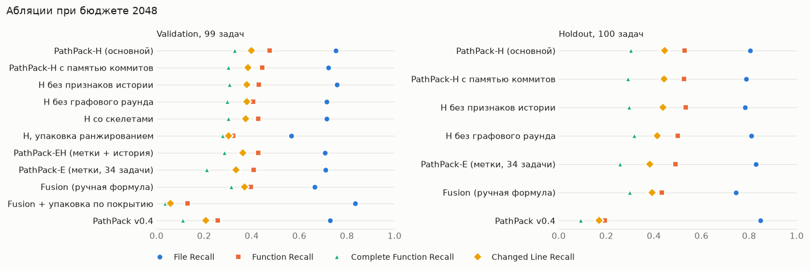
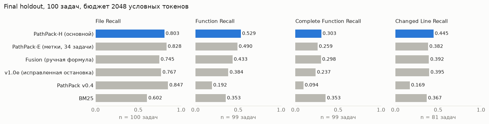
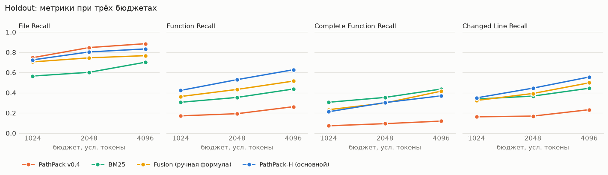
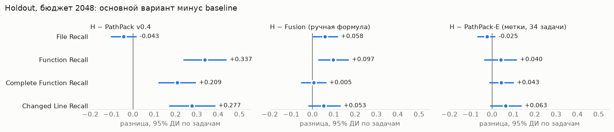
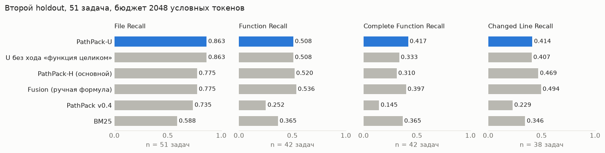
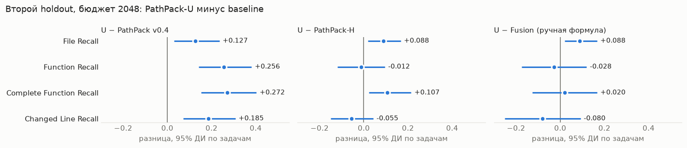
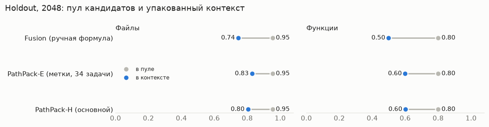
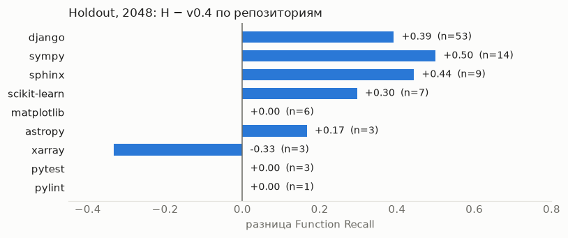

# Черновик статьи

Рабочее название: **History Replay: локализация правок под токен-бюджетом без меток бенчмарка**

Статус: все прогоны посчитаны. PathPack-H: validation (99 задач) и первый holdout (100 задач). PathPack-U: validation и второй holdout (51 задача). Holdout запускался один раз после заморозки (`output/pathpack_e/FREEZE_before_holdout.json`). Обзор литературы сверен с источниками. Эксперимента с LLM и пересчёта токенизатором Gemma нет.

---

## Аннотация

Малые локальные языковые модели работают с ограниченным контекстом, поэтому поиск кода должен уместить в бюджет те функции и строки, которые придётся менять. Мы показываем на SWE-bench Verified, что распространённая эвристическая упаковка находит файлы, но теряет функции: потери происходят при выборе из пула, а не при его построении. Мы предлагаем PathPack-H. Он оценивает вероятность правки для каждого фрагмента моделью, обученной **только на прошлых коммитах самих репозиториев** (history replay), без меток бенчмарка, и упаковывает контекст по ожидаемому покрытию на токен. На 100 отложенных задачах при бюджете 2048 условных токенов PathPack-H против нашего прежнего лучшего метода v0.4 даёт Function Recall 0.529 против 0.192, Complete Function Recall 0.303 против 0.094 и Changed Line Recall 0.445 против 0.169; интервалы разниц не включают ноль, в том числе при bootstrap по репозиториям. File Recall 0.803 против 0.847, разница −0.043 [−0.102, +0.017]. Против ручного слияния тех же каналов выигрыш меньше: значим только Function Recall (+0.097). Второй вариант, PathPack-U, добавляет вероятности правки функции и файла и упаковывает контекст, максимизируя сумму ожидаемых метрик; на втором отложенном наборе из 51 задачи он выше v0.4 по всем четырём метрикам, включая File Recall (0.863 против 0.735), и выше PathPack-H по File, но не лучше его по Function и Changed Line. Признаки истории, «память коммитов» и статический тестовый мост вклада не дали: история полезна как источник обучения, а не как признак. Обучение на истории коммитов известно на уровне файлов; наш вклад — уровень функций и строк под фиксированным бюджетом и проверка на отложенных данных. Долю исправленных ошибок мы не измеряли.

---

## 1. Введение

Агент, исправляющий ошибку в репозитории, должен выбрать несколько тысяч токенов из сотен тысяч. Для большой модели этот выбор менее критичен; для модели на ноутбуке он определяет, поместится ли вообще нужный код.

Мы рассматриваем задачу как **локализацию правки под бюджетом**: по тексту задачи и снимку репозитория на `base_commit` выбрать набор фрагментов кода, который содержит строки, которые реально меняет эталонное исправление. Метрики качества здесь — не сходство с текстом задачи, а покрытие изменённых строк и функций.

Вклад работы:

1. **Диагностика потерь.** Мы измеряем пул кандидатов и упакованный контекст раздельно и показываем, что основная потеря происходит на упаковке (раздел 6.2).
2. **Механизм сбоя.** Правило «остановиться, когда все названные символы покрыты» (v1.0) даёт нулевую предельную пользу повторному покрытию и пропускает нужный код. Исправленная остановка возвращает качество к v0.4 (раздел 6.3).
3. **PathPack-H: history replay на уровне функций под бюджетом.** Обучение локализатора на истории коммитов само по себе известно (раздел 3; ближайшая работа — CommitCompass, уровень файлов). Мы переносим его на уровень функций и строк и на выход фиксированного токен-бюджета: модель вероятности правки обучается на прошлых коммитах без единой метки бенчмарка, с временной защитой от утечки (раздел 4.5). На отложенных задачах она не уступает той же модели, обученной на размеченных задачах бенчмарка, и превосходит v0.4 по функциям и строкам (раздел 6.6).
3b. **PathPack-U: упаковка под ожидаемые метрики.** Вероятности правки на трёх уровнях (фрагмент, функция, файл), обученные на истории, и цель упаковки, равная сумме ожидаемых File, Function, Complete и Changed Line Recall с весами, выведенными из истории, а не подобранными (раздел 4.6). Аналога в найденных работах мы не обнаружили. На втором отложенном наборе это первый наш вариант, который выше v0.4 по всем четырём метрикам (раздел 6.7).
3a. **Упаковка по ожидаемому покрытию.** Жадный выбор по вероятности правки на токен с бонусом за новый файл (раздел 4.4). Абляция показывает, что упаковка ранжированием с той же моделью теряет 0.16 File Recall, а та же упаковка с некалиброванными баллами разрушает покрытие функций (раздел 6.5).
4. **Протокол.** Сплиты на 500 задач с проверкой на пересечения, кластерный bootstrap, раздельные метрики для чистых вставок (раздел 5).

Мы не утверждаем превосходства над агентами-программистами и не измеряем долю исправленных ошибок: это требует запуска LLM на той же упаковке (раздел 8).

---

## 2. Постановка

Вход: репозиторий `R` на `base_commit`, текст задачи `Q`, бюджет `B`. Выход: набор фрагментов `S` с `TokenCost(S) ≤ B`.

Условные токены: `ceil(UTF-8 bytes / 4)` по всему сериализованному контексту, включая заголовки и пути. Это не токенизатор Gemma. `[TBD: пересчёт настоящим токенизатором, если доступен]`

Gold-патч используется только при оценке. Признаки, пул и упаковка его не читают; это проверяется тестами.

**Метрики.**

- **File Recall** — доля изменённых файлов, покрытых контекстом.
- **Function Recall** — доля изменённых функций, у которых покрыты строки тела. Совпадение имени не считается.
- **Complete Function Recall** — доля функций, покрытых целиком.
- **Changed Line Recall** — доля удалённых или заменённых базовых строк. Чистые вставки сюда не входят.
- **Insertion Anchor Recall** — отдельная метрика для вставок: строки, между которыми вставлен код.

Для каждой метрики указывается число задач, на которых она определена. У 16 из 20 диагностических задач разметка неполная, поэтому задачи без значения не считаются нулём.

---

## 3. Связанные работы

Проверено по страницам arXiv и репозиториев 11 ноября 2026. HTML-версии статей читались не целиком (первые ~40 тыс. символов дословно), поэтому ниже приведено только то, что прочитано дословно.

**Обучение и поиск по истории коммитов — уже существующая идея.**

- **CommitCompass** (репозиторий `VijayChamakuri/commitcompass`, без статьи и рецензирования). Ближайшая к нам работа. Ранжировщик на градиентном бустинге по 18 признакам, обученный только на парах «сообщение коммита → изменённые файлы», 3000 коммитов до первой задачи каждого репозитория, те же 12 репозиториев SWE-bench; есть вариант leave-one-repo-out. Оценка на 300 задачах SWE-bench Lite, уровень файла, Acc@k и MRR (заявлено Acc@1 47.7). Токен-бюджета и упаковки фрагментов нет; авторы сами отмечают, что обучающие запросы — сообщения коммитов, а не задачи.
- **Gandhi, Gao, Callan. Repository-level Code Search with Neural Retrieval Methods** (arXiv:2502.07067, 2025). BM25 по сообщениям коммитов и два reranker на CodeBERT, обученные на тройках из коммитов; сообщения переписываются GPT-4 в стиль задач. Уровень файла, MAP/MRR/P@k/R@k на собственном наборе из 7 репозиториев.
- **IssueExec** (arXiv:2607.17286, препринт 2026) и **Issue-Test-Localizer** (IBM, репозиторий). Используют существующие тесты как мост между задачей и кодом через трассы исполнения и покрытие. Мы видели только выдержки из поисковой выдачи, полный текст не читали. Наша статическая версия этой идеи сигнала не дала (раздел 6.8).
- **Wang и др. Improving Code Localization with Repository Memory** (arXiv:2510.01003, ICLR 2026). BM25 по сообщениям 7000 коммитов до `base_commit` как инструмент агента (без обучения), плюс сводки по самым часто меняемым файлам. SWE-bench Verified, уровень файла, Acc@1/3/5 (68.6 / 74.5 / 76.5 с GPT-4o). Это прямой аналог нашей «памяти коммитов».
- Классическая IR-локализация багов использовала историю изменений задолго до LLM: BugLocator (Zhou, Zhang, Lo, ICSE 2012) ранжирует файлы по сходству с отчётом; Locus (Wen, Wu, Cheung, ASE 2016) использует историю изменений. `[TBD: Ye, Bunescu, Liu, FSE 2014 — не удалось проверить по источнику]`

**Локализация задач ранжированием и агентами.**

- **SweRank** (Reddy и др., arXiv:2505.07849, ICLR 2026). Bi-encoder SweRankEmbed (137M и 7B) и listwise-reranker SweRankLLM (7B и 32B). Обучены на SweLoc: пары «задача → изменённые функции» из PR 3387 репозиториев, репозитории SWE-bench исключены. Оценка на SWE-bench Lite и LocBench, Acc@k на уровне файла, модуля и функции.
- **LocAgent** (Chen и др., arXiv:2503.09089, 2025). Агент над графом кода; дообучение Qwen2.5-Coder на 768 успешных траекториях из train-части SWE-bench.
- **CoSIL** (Jiang и др., arXiv:2503.22424, ASE 2025). Итеративный поиск LLM по графу вызовов без обучения; Top-1 43.3% на Lite и 44.6% на Verified с Qwen2.5-Coder-32B.
- **OrcaLoca** (Yu и др., arXiv:2502.00350, ICML 2025). Агент с очередью действий и обрезкой контекста по расстоянию; function match rate 65.33% на Lite.
- **Agentless** (Xia и др., arXiv:2407.01489, 2024). Трёхфазный конвейер без агента: локализация, исправление, проверка.
- **SWE-bench** (Jimenez и др., arXiv:2310.06770, ICLR 2024). Бенчмарк; метрик локализации не определяет.

**Чем наша работа отличается и чем не отличается.** Идея «обучать локализатор на истории коммитов без меток бенчмарка» не нова: CommitCompass делает это тем же классом моделей на тех же репозиториях, а память коммитов как BM25-канал описана у Wang и др. Наши отличия уже и конкретнее: (1) метки и оценка на уровне функций и строк, а не файлов (положительные примеры берутся из заголовков ханков); (2) выход — контекст фиксированного токен-бюджета, а не ранжированный список, и модель используется как вероятность в упаковке по ожидаемому покрытию; (3) контроль с той же моделью, обученной на метках бенчмарка; (4) замороженный протокол с отложенным набором на SWE-bench Verified и интервалами. Наши числа (Recall@Budget) несопоставимы с Acc@k этих работ, прямое сравнение не проводилось. Наш отрицательный результат по памяти коммитов расходится с положительным у Wang и др.; у них память — инструмент агента на уровне файлов, у нас — признак модели, и это разные условия.

---

## 4. Методы

### 4.1 Базовые методы

- **BM25** по фрагментам кода и отдельно по именам функций, файлов и классов.
- **Graph Expansion** — BM25 с распространением по рёбрам графа зависимостей.
- **PathPack v0.4** — BM25 с AST-чанками, графовым распространением на 2 перехода, diversity и учётом стоимости. Лучший устойчивый baseline на диагностике.
- **PathPack v1.0** — совместная оптимизация по свидетельствам из текста задачи; остановка при покрытии названных символов.
- **PathPack v1.0e** — то же, но повторное покрытие получает убывающую полезность, а кандидаты с независимым сигналом можно добавлять (`repeat_weight 0.35`).

### 4.2 Мультиисточниковое слияние (fusion)

Каналы: лексический (BM25 по коду), символьный (точное совпадение идентификаторов из текста, включая CamelCase и квалифицированные имена), семантический (UniXcoder-base, mean pooling, ревизия `5604afdc…`, косинусная близость), структурный (вызовы, импорты, наследование, один-два перехода). Каналы объединяются, а не фильтруются последовательно. Каждый кандидат хранит свои ранги и пределы.

Итоговый балл: `0.40·lexical + 0.25·symbol + 0.20·semantic + 0.15·graph`. Упаковка жадная по предельной полезности, без остановки по покрытию символов.

### 4.3 Reranker (отрицательный результат)

Мы пробовали zero-shot cross-encoder `ms-marco-MiniLM-L-6-v2`. Он обучен на веб-пассажах, а не на коде. В собственной проверке он давал 0.006 паре с совпадающим именем и 1e-5 несвязанной паре. На диагностике вариант с reranker не дал выигрыша над fusion. Мы сохраняем его как абляцию, а не как вклад.

### 4.4 PathPack-E

**Цель.** Оценить `p(c) = P(в фрагменте c будет правка | Q, R)` и упаковать по ожидаемому покрытию.

**Признаки стадии 1** (33 шт., из них 6 по истории): лексический, семантический, символьный и графовый балл; ранги по каждому каналу; размер фрагмента и функции; позиция фрагмента в функции; максимумы и процентили по файлу и пулу; история до `base_commit`: частота правок файла, bugfix-коммиты (по ключевым словам в теме), co-change с топ-файлами пула и с символьными файлами. История читается из `git log` снимка, который стоит на `base_commit`, поэтому коммит исправления в ней отсутствует.

**Стадия 2.** Один раунд распространения по рёбрам `calls`: максимум вероятности вызывающих и вызываемых функций из стадии 1, максимум по файлу и по функции. Стадия 2 обучается на out-of-fold вероятностях стадии 1, сгруппированных по задаче.

**Модель.** Градиентный бустинг (`HistGradientBoostingClassifier`, глубина 4, 200 итераций, `min_samples_leaf 40`, `l2 1.0`). Обучение только на train-pool; проверка пересечений с eval-манифестами перед обучением.

**Упаковка.** Жадно по `gain / cost`, где

`gain(c) = p(c)·(1 − overlap(c, выбранное)) + 0.25·p_file(c)·[первый фрагмент файла]`.

Остановка — по порогу предельной пользы `0.004` или по бюджету. Вариант `skeleton` добавляет кандидатов из одной строки сигнатуры с весом `0.15`.

**Что не делаем.** Нет остановки по покрытию названных символов. Нет ручных весов рёбер в финальной модели (они только в базовых методах).

**Абляции:** без графа (`nograph`), без истории (`nohist`), с упаковкой ранжированием (`ranked`), со скелетами (`skeleton`).

### 4.5 PathPack-H: обучение на истории без меток бенчмарка

PathPack-E требует размеченных задач. PathPack-H использует ту же модель и ту же упаковку, но обучается **только на прошлых коммитах самих репозиториев**.

**Память коммитов.** Темы прошлых коммитов индексируются BM25. Для новой задачи берутся 20 самых похожих коммитов; файлы, которые они меняли, получают голос, взвешенный по сходству и делённый на число файлов коммита. Это два признака стадии 1 (`memory_file`, `memory_file_pct`).

**History replay.** Для каждого репозитория берётся снимок задачи Verified с самым ранним `base_commit`. Коммиты, предшествующие ему, «проигрываются» как псевдо-задачи: сообщение коммита играет роль текста задачи, а положительные примеры — фрагменты, чьё имя функции или класса стоит в заголовке ханка (`git log -p -U0`, драйвер `diff=python`) в изменённом не-тестовом файле. Фильтры: не более 8 изменённых production-файлов, не менее 4 различных термов в сообщении, хотя бы один положительный пример в пуле.

**Защита от утечки.** (1) Читаются только предки самого раннего `base_commit` репозитория. (2) Коммит должен быть старше самого раннего `created_at` среди всех задач Verified этого репозитория, поэтому ни один коммит-исправление бенчмарка в обучение не попадает. (3) Признаки истории и память для проигрываемого коммита строятся только по строго более старым коммитам (`History.after`). Модуль не обращается к полю `patch` датасета; это проверяется тестом.

**Ограничения приёма.** Код берётся из снимка, а не из дерева на момент коммита: переименованные или удалённые с тех пор функции не дают положительных примеров. Сообщение коммита описывает исправление, а текст задачи описывает симптом; это сдвиг распределения, и его величину показывает сравнение H против E на validation. Часть пакетов логов недоступна в частичном клоне (`blob:none`); такие пакеты пропускаются и считаются. Пропущено 47 пакетов; псевдо-задач по репозиториям: от 56 (requests) до 120 (потолок), всего 1295.

Абляции H: без памяти (`nomemory`), без всей истории (`nohist`), без графового раунда (`nograph`), упаковка ранжированием (`ranked`), со скелетами (`skeleton`). `pathpack-eh` обучается на объединении меток и истории.

### 4.6 PathPack-U: упаковка под ожидаемые метрики

PathPack-H ранжирует фрагменты и упаковывает их жадно с одним ручным бонусом за новый файл. На holdout он уступил BM25 по Complete Function Recall, а на рис. 5 видно, что пятая часть золотых функций теряется между пулом и контекстом. PathPack-U меняет постановку упаковки: выбрать набор `S`, максимизирующий сумму ожидаемых значений самих метрик.

**Три уровня вероятностей.** Модель фрагмента — та же, что в PathPack-H. Две дополнительные модели оценивают `P(g)` — вероятность правки функции и `P(f)` — вероятность правки файла. Их входы — агрегаты по фрагментам единицы: максимум, среднее, сумма и второе по величине значение вероятности фрагмента, noisy-OR, число фрагментов в пуле, максимумы лексического, семантического, символьного и графового баллов, размер функции, процентили файла. Обучение на тех же псевдо-задачах из истории; вероятности фрагментов для обучения берутся out-of-fold (5 фолдов по псевдо-задачам). Метки бенчмарка не используются; модуль обучения отказывается от любых данных, кроме history replay.

**Цель.**

`U(S) = w_file·Σ_f P(f)·[S касается f] + w_fn·Σ_g P(g)·[cov_g(S) ≥ θ] + w_fn·Σ_g P(g)·[cov_g(S) = 1] + w_chunk·Σ_c P(c)·[c ∈ S]`

Четыре слагаемых соответствуют File, Function, Complete Function и Changed Line Recall. `θ = 0.20` — порог покрытия, который использует сама метрика Function Recall. Покрытие функции считается по токенам её фрагментов.

**Веса не подбираются.** `w_file`, `w_fn`, `w_chunk` равны обратным средним числам правленых файлов, функций и фрагментов на одну псевдо-задачу истории, так что каждое слагаемое — ожидаемый recall. По 1295 псевдо-задачам: в среднем 1.23 правленых файла, 2.60 функции и 9.52 фрагмента на задачу, откуда `w_file = 0.815`, `w_fn = 0.384`, `w_chunk = 0.105`. Модели уровня функции и файла обучены на 127 871 и 47 203 строках.

**Выбор.** Жадно по приросту `U` на токен, с двумя видами ходов: добавить один фрагмент или добавить все оставшиеся фрагменты одной функции. Второй ход нужен потому, что слагаемое завершения не зарабатывается ни одним отдельным фрагментом, и обычный жадный алгоритм его никогда не оплатит. Для 60 функций с наибольшей `P(g)` в кандидаты добавляются их фрагменты, не попавшие в пул, с нулевой вероятностью фрагмента. Остановка — по бюджету или при отсутствии положительного прироста.

**Абляция:** `pathpack-u/nobundle` — та же цель без хода «функция целиком».

**Оценка.** Первый holdout использован для PathPack-H, поэтому для PathPack-U выделен второй отложенный набор: 51 задача из исходных 151, не вошедшая в первый holdout и ни разу не запускавшаяся (`final_holdout2_manifest.json`, записан до измерений). Результаты — в разделе 6.7.

---

## 5. Протокол

**Данные.** SWE-bench Verified, 500 задач на зеркалах Git. Снимки на точных `base_commit`: 500 из 500 задач.

**Сплиты.**

| Набор | Назначение | Размер | Фиксация |
|---|---|---:|---|
| diagnostic | диагностика, многократно использован | 20 | — |
| train-pool | обучение PathPack-E | 45 собрано, 34 с положительными (из 170) | `output/pathpack_r_splits_v2/train_110.jsonl` |
| history replay | обучение PathPack-H | 1295 псевдо-задач | `output/pathpack_e/train_history`, план в `replay_logs/plan.json` |
| validation | выбор варианта | 99 | `validation_issues.jsonl` |
| final holdout | однократная оценка | 100 (из 151) | `final_holdout_100_manifest.json`, sha256 в манифесте |

Разделение по задачам, а не по репозиториям: `repository_disjoint: false`. Поэтому для основных сравнений дополнительно приводится bootstrap с кластеризацией по репозиторию. Repository-disjoint проверка не проводилась.

Пересечения проверяются на уровне `instance_id` перед обучением; обучение отказывается при пересечении с eval-манифестами (тест `test_fit_refuses_overlap_with_evaluation_manifest`).

**Правило выбора варианта.** Фиксируется до validation: в финал идёт вариант, у которого File Recall не хуже v0.4 минус 0.05 и который выигрывает минимум по двум из Function / Complete / Changed Line с 95% интервалом, не включающим ноль. Если такого нет, финал описывает диагностику.

**Статистика.** Парный bootstrap по задачам (2000 итераций, seed 42), разница «кандидат минус v0.4», 95% интервал, число побед, ничьих и поражений. Вывод о превосходстве не делается, если результат обеспечен одной задачей.

**Заморозка перед holdout.** Git-хэш кода, конфиг, версии моделей (`microsoft/unixcoder-base@5604afdc`, `cross-encoder/ms-marco-MiniLM-L-6-v2@233902d2`), манифест выборки, список baseline.

---

## 6. Результаты

### 6.1 Диагностика (20 задач, бюджет 2048)

Диагностический набор использован ранее многократно; результаты ниже не являются независимыми.

| Метод | File | Function | Complete | Changed Line | Загрузка бюджета |
|---|---:|---:|---:|---:|---:|
| BM25 | 0.350 | 0.111 | 0.111 | 0.143 | 0.995 |
| PathPack v0.4 | 0.725 | 0.202 | 0.091 | 0.148 | 0.992 |
| PathPack v1.0 | 0.475 | 0.171 | 0.060 | 0.077 | 0.348 |
| PathPack v1.0e | 0.700 | 0.250 | 0.083 | 0.238 | 0.808 |
| PathPack-R / fusion | 0.650 | 0.234 | 0.234 | 0.293 | 0.951 |
| PathPack-R / reranker | 0.625 | 0.250 | 0.083 | 0.333 | 0.473 |

Разница fusion минус v0.4 (n = 20 для File, 18 для Function и Complete, 14 для Changed Line):

| Метрика | Разница | 95% ДИ | Побед / ничьих / поражений |
|---|---:|---|---|
| File | −0.075 | [−0.300, +0.150] | 3 / 13 / 4 |
| Function | +0.032 | [−0.135, +0.194] | 3 / 14 / 1 |
| Complete | +0.143 | [+0.008, +0.310] | 4 / 14 / 0 |
| Changed Line | +0.145 | [0.000, +0.341] | 3 / 11 / 0 |

Проверка на непросмотренных задачах — в разделах 6.4 и 6.6.

### 6.2 Потери на упаковке

На диагностике при 2048 File Pool Recall у R/full — 0.90, упакованный File Recall — 0.525. Function Pool Recall — 0.667, упакованный — 0.278. Потери происходят на этапе выбора, а не на этапе генерации кандидатов.

### 6.3 Механизм сбоя v1.0

Когда все названные символы покрыты, предельная польза новых фрагментов обнуляется, и отбор прекращается. В разборе `django__django-12276`: текст называет `FileInput`, `ClearableFileInput` и `use_required_attribute`; v1.0 выбирает два фрагмента одного файла и 127 токенов из 2048, v0.4 занимает 12 файлов и 2005 токенов. Исправленная остановка (v1.0e) возвращает File Recall к 0.700.

### 6.4 Базовые методы на validation (99 непросмотренных задач, бюджет 2048)

Эти задачи не использовались при разработке. Прогон `output/pathpack_r_val_base` (слияние двух частей 80 + 19 задач одним кодом), аудит бюджетов прошёл.

| Метод | File | Function (n=89) | Complete (n=89) | Changed Line (n=78) | Insertion Anchor | Загрузка |
|---|---:|---:|---:|---:|---:|---:|
| BM25 | 0.469 | 0.295 | 0.295 | 0.259 | 0.213 | 0.995 |
| PathPack v0.4 | 0.728 | 0.258 | 0.112 | 0.207 | 0.145 | 0.993 |
| PathPack v1.0e | 0.712 | 0.370 | 0.202 | 0.329 | 0.272 | 0.835 |
| PathPack-R (reranker + active) | 0.575 | 0.243 | 0.156 | 0.211 | 0.160 | 0.675 |
| PathPack-R / reranker-graph | 0.625 | 0.270 | 0.201 | 0.250 | 0.160 | 0.682 |
| PathPack-R / fusion | 0.665 | 0.396 | 0.315 | 0.371 | 0.289 | 0.949 |

Парная разница с v0.4, 95% ДИ (bootstrap по задачам), победы / ничьи / поражения:

| Кандидат | File | Function | Complete | Changed Line |
|---|---|---|---|---|
| fusion | −0.063 [−0.140, +0.011], 5/79/15 | +0.138 [+0.050, +0.227], 23/60/6 | +0.203 [+0.123, +0.289], 24/63/2 | +0.164 [+0.079, +0.249], 22/51/5 |
| v1.0e | −0.016 [−0.101, +0.066], 8/79/12 | +0.112 [+0.019, +0.206], 19/62/8 | +0.091 [+0.012, +0.169], 12/73/4 | +0.122 [+0.036, +0.218], 17/56/5 |
| BM25 | −0.259 [−0.355, −0.170], 3/63/33 | +0.037 [−0.053, +0.126] | +0.184 [+0.094, +0.279] | +0.052 [−0.032, +0.135] |

Наблюдения. (1) Диагностический вывод перенёсся на новые задачи: fusion выше v0.4 по Function, Complete и Changed Line, интервалы не включают ноль; по File точечная оценка ниже на 0.063, интервал включает ноль. (2) Zero-shot reranker MS-MARCO ухудшает fusion по всем четырём метрикам. (3) v0.4 на новых задачах проигрывает простому BM25 по Complete Function Recall: его ширина по файлам куплена ценой полноты функций. (4) Исправление одной только остановки (v1.0e) уже даёт значимый выигрыш над v0.4 по трём метрикам без потери File.

По заранее записанному правилу выбора: v1.0e проходит (File −0.016 ≥ −0.05, три метрики с интервалом выше нуля); fusion формально не проходит порог по File (−0.063 < −0.05), хотя по остальным метрикам сильнее.

### 6.5 PathPack-E и PathPack-H на validation (99 задач, бюджет 2048)

Обучение: E — 34 размеченные задачи train-pool с положительными примерами (из 45 собранных; 57 положительных фрагментов). H — 1295 псевдо-задач из коммитов 12 репозиториев (12 329 положительных фрагментов). Из логов коммитов 47 пакетов по 20 коммитов не скачались в частичном клоне и пропущены. Пересечений с validation, holdout и прежними 80 задачами нет (проверка при обучении).

| Метод | File | Function | Complete | Changed Line |
|---|---:|---:|---:|---:|
| PathPack v0.4 | 0.728 | 0.258 | 0.112 | 0.207 |
| R / fusion | 0.665 | 0.396 | 0.315 | 0.371 |
| PathPack-E (метки) | 0.710 | 0.408 | 0.211 | 0.335 |
| PathPack-EH (метки + история) | 0.707 | 0.427 | 0.286 | 0.363 |
| PathPack-H | 0.722 | 0.444 | 0.303 | 0.383 |
| H без памяти коммитов | 0.752 | 0.474 | 0.329 | 0.399 |
| H без признаков истории | 0.757 | 0.429 | 0.306 | 0.379 |
| H без графового раунда | 0.714 | 0.406 | 0.298 | 0.379 |
| H со скелетами | 0.715 | 0.427 | 0.303 | 0.374 |
| H, упаковка ранжированием | 0.565 | 0.321 | 0.279 | 0.303 |
| fusion + упаковка по покрытию | 0.835 | 0.130 | 0.038 | 0.057 |

По правилу выбора проходят E, EH, H и абляции H, кроме `ranked`. Основным вариантом для holdout выбран **H без памяти коммитов** (`pathpack-h/nomemory`): лучшие точечные оценки среди вариантов на истории. Выбор сделан только по validation и записан в файл заморозки до запуска holdout.

Что показали абляции на validation. Память коммитов не помогает (вариант без неё не хуже). Признаки истории в целом не дают различимого вклада. Скелеты сигнатур не дают вклада. Упаковка ранжированием с той же моделью теряет File Recall (−0.163 к v0.4, интервал [−0.264, −0.069]). Упаковка по покрытию с баллами fusion вместо вероятностей поднимает File до 0.835, но разрушает Function (0.130): бонус за новый файл перевешивает некалиброванные баллы.



*Рис. 4. Абляции при бюджете 2048: validation слева, holdout справа.*

### 6.6 Final holdout (100 задач, один прогон после заморозки)

Прогон `output/pathpack_holdout`. Хэш дерева исходников после прогона совпал с записанным в файле заморозки. Аудит бюджетов и повторов прошёл. Function и Complete определены на 99 задачах, Changed Line на 81.

| Метод | Бюджет | File | Function | Complete | Changed Line | Insertion Anchor |
|---|---:|---:|---:|---:|---:|---:|
| BM25 | 2048 | 0.602 | 0.353 | 0.353 | 0.367 | 0.271 |
| PathPack v0.4 | 2048 | 0.847 | 0.192 | 0.094 | 0.169 | 0.061 |
| PathPack v1.0e | 2048 | 0.767 | 0.384 | 0.237 | 0.395 | 0.258 |
| R / fusion | 2048 | 0.745 | 0.433 | 0.298 | 0.392 | 0.276 |
| PathPack-E (метки) | 2048 | 0.828 | 0.490 | 0.259 | 0.382 | 0.226 |
| PathPack-H (с памятью) | 2048 | 0.788 | 0.526 | 0.293 | 0.443 | 0.270 |
| **PathPack-H (основной, без памяти)** | 2048 | 0.803 | 0.529 | 0.303 | 0.445 | 0.276 |
| H без признаков истории | 2048 | 0.783 | 0.534 | 0.298 | 0.437 | 0.288 |
| H без графового раунда | 2048 | 0.808 | 0.499 | 0.318 | 0.413 | 0.288 |
| PathPack v0.4 | 1024 | 0.747 | 0.171 | 0.073 | 0.162 | 0.024 |
| PathPack-H (основной) | 1024 | 0.725 | 0.423 | 0.212 | 0.349 | 0.207 |
| BM25 | 1024 | 0.565 | 0.306 | 0.306 | 0.337 | 0.159 |
| PathPack v0.4 | 4096 | 0.885 | 0.262 | 0.119 | 0.232 | 0.174 |
| PathPack-H (основной) | 4096 | 0.833 | 0.627 | 0.370 | 0.556 | 0.388 |
| BM25 | 4096 | 0.702 | 0.437 | 0.437 | 0.444 | 0.320 |



*Рис. 1. Final holdout, бюджет 2048: четыре метрики по шести методам. Синим выделен основной вариант, выбранный до прогона.*



*Рис. 2. Final holdout: метрики при бюджетах 1024, 2048 и 4096. У v0.4 покрытие функций и строк почти не растёт с бюджетом; BM25 выше PathPack-H по Complete Function Recall.*

Основные сравнения при 2048 (заявлены до прогона). Первый интервал — bootstrap по задачам, второй — по репозиториям (9 кластеров, 4000 итераций).

| Сравнение | Метрика | Разница | 95% ДИ по задачам | 95% ДИ по репозиториям | Побед / ничьих / поражений |
|---|---|---:|---|---|---|
| H − v0.4 | File | −0.043 | [−0.102, +0.017] | [−0.167, +0.019] | 4 / 85 / 11 |
| H − v0.4 | Function | +0.337 | [+0.235, +0.442] | [+0.095, +0.404] | 42 / 52 / 5 |
| H − v0.4 | Complete | +0.209 | [+0.122, +0.301] | [+0.034, +0.263] | 27 / 68 / 4 |
| H − v0.4 | Changed Line | +0.277 | [+0.168, +0.386] | [+0.049, +0.334] | 34 / 41 / 6 |
| H − fusion | File | +0.058 | [−0.000, +0.123] | [−0.018, +0.127] | 10 / 87 / 3 |
| H − fusion | Function | +0.097 | [+0.029, +0.176] | [+0.000, +0.219] | 14 / 81 / 4 |
| H − fusion | Complete | +0.005 | [−0.052, +0.069] | [−0.045, +0.096] | 6 / 87 / 6 |
| H − fusion | Changed Line | +0.053 | [−0.018, +0.129] | [−0.024, +0.174] | 13 / 61 / 7 |



*Рис. 3. Holdout, бюджет 2048: разница «основной вариант минус baseline», 95% интервал парного bootstrap по задачам.*

Вторичные сравнения при 2048 (bootstrap по задачам): H − E: File −0.025 [−0.065, +0.015], Function +0.040 [−0.037, +0.115], Complete +0.043 [−0.014, +0.105], Changed Line +0.063 [−0.009, +0.134]. H − H без графа: все четыре интервала включают ноль. fusion − v0.4: File −0.102 [−0.173, −0.032], Function +0.240, Complete +0.204, Changed Line +0.224 (интервалы выше нуля). v1.0e − v0.4: File −0.080 [−0.152, −0.012], остальные три выше нуля.

Латентность запроса PathPack-H около 0.42 с при готовом индексе; индекс эмбеддингов на задачу строится минуты (4096 фрагментов UniXcoder).

### 6.7 PathPack-U

**Validation (99 задач, бюджет 2048).** Прогон `output/pathpack_val_all2`, аудит бюджетов прошёл. PathPack-U разрабатывался после того, как validation уже использовался для PathPack-H, поэтому эти числа служат проверкой перед отложенным набором, а не независимой оценкой.

| Метод | File | Function | Complete | Changed Line | Insertion Anchor | Латентность, с |
|---|---:|---:|---:|---:|---:|---:|
| BM25 | 0.469 | 0.295 | 0.295 | 0.259 | 0.213 | 0.01 |
| PathPack v0.4 | 0.728 | 0.258 | 0.112 | 0.207 | 0.145 | <0.01 |
| R / fusion | 0.665 | 0.396 | 0.315 | 0.371 | 0.289 | 0.67 |
| PathPack-H (основной) | 0.752 | 0.474 | 0.329 | 0.399 | 0.251 | 0.53 |
| **PathPack-U** | 0.854 | 0.439 | 0.351 | 0.380 | 0.316 | 1.16 |
| U без хода «функция целиком» | 0.844 | 0.445 | 0.316 | 0.373 | 0.313 | 1.12 |

При других бюджетах: 1024 — U: File 0.828, Function 0.324, Complete 0.212, Changed Line 0.244 (H: 0.688 / 0.324 / 0.179 / 0.257); 4096 — U: 0.860 / 0.469 / 0.404 / 0.428 (H: 0.767 / 0.555 / 0.390 / 0.460).

Парные разницы при 2048, 95% ДИ по задачам, победы / ничьи / поражения:

| Сравнение | File | Function | Complete | Changed Line |
|---|---|---|---|---|
| U − v0.4 | +0.126 [+0.047, +0.207], 17/76/6 | +0.181 [+0.088, +0.274], 25/61/3 | +0.240 [+0.163, +0.327], 28/61/0 | +0.173 [+0.098, +0.255], 22/55/1 |
| U − H | +0.102 [+0.049, +0.165], 12/87/0 | −0.036 [−0.109, +0.039], 5/73/11 | +0.022 [−0.039, +0.090], 7/78/4 | −0.019 [−0.082, +0.042], 6/62/10 |
| U − BM25 | +0.385 [+0.293, +0.478] | +0.143 [+0.054, +0.233] | +0.056 [−0.034, +0.152], 19/59/11 | +0.121 [+0.037, +0.207] |
| U − U без bundle | +0.010 [0.000, +0.030] | −0.007 [−0.040, +0.020] | +0.035 [−0.001, +0.081], 5/81/3 | +0.007 [−0.006, +0.028] |

Что видно на validation. (1) PathPack-U — первый наш вариант, который выше v0.4 по всем четырём метрикам одновременно, включая File Recall. (2) Относительно PathPack-H он добавляет файлы (+0.102, ни одного поражения), а по Function, Complete и Changed Line различий нет; при бюджете 4096 Function Recall у U ниже (0.469 против 0.555). (3) Ход «функция целиком» почти не влияет: прирост Complete +0.035 с интервалом, касающимся нуля. (4) По Complete Function Recall U выше BM25 по точечной оценке, но интервал включает ноль. (5) Латентность примерно вдвое выше, чем у H.

То есть трёхуровневая цель перераспределяет бюджет в пользу покрытия файлов, не теряя функций и строк на бюджете 2048, но не улучшает локализацию внутри файла.

**Второй holdout (51 задача, один прогон после заморозки).** Заморозка `output/pathpack_e/FREEZE_before_holdout2.json` записана до прогона; хэш дерева исходников после прогона совпал с записанным, аудит бюджетов прошёл. Заявлены две гипотезы: H1 — U выше v0.4 по Function, Complete и Changed Line и не ниже по File; H2 — U выше PathPack-H по File. Function и Complete определены на 42 задачах, Changed Line на 38.

| Метод | Бюджет | File | Function | Complete | Changed Line | Insertion Anchor |
|---|---:|---:|---:|---:|---:|---:|
| BM25 | 2048 | 0.588 | 0.365 | 0.365 | 0.346 | 0.190 |
| PathPack v0.4 | 2048 | 0.735 | 0.252 | 0.145 | 0.229 | 0.111 |
| R / fusion | 2048 | 0.775 | 0.536 | 0.397 | 0.494 | 0.376 |
| PathPack-H | 2048 | 0.775 | 0.520 | 0.310 | 0.469 | 0.264 |
| **PathPack-U** | 2048 | 0.863 | 0.508 | 0.417 | 0.414 | 0.329 |
| U без хода «функция целиком» | 2048 | 0.863 | 0.508 | 0.333 | 0.407 | 0.319 |
| PathPack v0.4 | 1024 | 0.618 | 0.157 | 0.073 | 0.173 | 0.048 |
| PathPack-H | 1024 | 0.755 | 0.385 | 0.226 | 0.294 | 0.252 |
| PathPack-U | 1024 | 0.863 | 0.411 | 0.315 | 0.345 | 0.214 |
| PathPack v0.4 | 4096 | 0.892 | 0.339 | 0.232 | 0.308 | 0.219 |
| PathPack-H | 4096 | 0.814 | 0.609 | 0.514 | 0.534 | 0.309 |
| PathPack-U | 4096 | 0.863 | 0.667 | 0.575 | 0.559 | 0.409 |



*Рис. 7. Второй holdout, бюджет 2048: четыре метрики по шести методам.*

Парные разницы при 2048. Первый интервал — bootstrap по задачам, второй — по репозиториям (4000 итераций).

| Сравнение | Метрика | Разница | 95% ДИ по задачам | 95% ДИ по репозиториям | Побед / ничьих / поражений |
|---|---|---:|---|---|---|
| U − v0.4 | File | +0.127 | [+0.029, +0.235] | [−0.045, +0.274] | 8 / 42 / 1 |
| U − v0.4 | Function | +0.256 | [+0.141, +0.381] | [+0.060, +0.360] | 14 / 28 / 0 |
| U − v0.4 | Complete | +0.272 | [+0.153, +0.403] | [+0.036, +0.388] | 14 / 28 / 0 |
| U − v0.4 | Changed Line | +0.185 | [+0.071, +0.308] | [−0.015, +0.303] | 11 / 25 / 2 |
| U − H | File | +0.088 | [+0.020, +0.167] | [0.000, +0.241] | 5 / 46 / 0 |
| U − H | Function | −0.012 | [−0.119, +0.095] | [−0.158, +0.033] | 3 / 36 / 3 |
| U − H | Complete | +0.107 | [+0.024, +0.214] | [0.000, +0.159] | 5 / 37 / 0 |
| U − H | Changed Line | −0.055 | [−0.150, +0.043] | [−0.160, −0.017] | 3 / 30 / 5 |
| U − fusion | File | +0.088 | [+0.020, +0.167] | [0.000, +0.119] | 5 / 46 / 0 |
| U − fusion | Function | −0.028 | [−0.175, +0.119] | [−0.261, +0.054] | 5 / 30 / 7 |
| U − fusion | Complete | +0.020 | [−0.127, +0.167] | [−0.263, +0.126] | 6 / 30 / 6 |
| U − fusion | Changed Line | −0.080 | [−0.252, +0.091] | [−0.306, −0.005] | 6 / 24 / 8 |
| U − U без bundle | Complete | +0.083 | [+0.012, +0.179] | [0.000, +0.122] | 4 / 38 / 0 |



*Рис. 8. Второй holdout, бюджет 2048: PathPack-U минус baseline, 95% интервал по задачам.*

Итог по заявленным гипотезам. **H1 подтверждена** при bootstrap по задачам: U выше v0.4 по всем четырём метрикам, включая File. При кластеризации по репозиториям интервалы по Function и Complete остаются выше нуля, по File и Changed Line включают ноль. **H2 подтверждена** при bootstrap по задачам (+0.088, ни одного поражения); при кластеризации нижняя граница равна нулю.

Вторичные наблюдения, не заявленные заранее. (1) U выше PathPack-H по Complete Function Recall (+0.107), и этот прирост даёт ход «функция целиком»: без него Complete падает с 0.417 до 0.333 при тех же остальных метриках. На validation тот же эффект был слабее (+0.035). (2) По Changed Line Recall U ниже PathPack-H и fusion по точечной оценке, а при кластеризации по репозиториям интервалы лежат ниже нуля: покрытие файлов и целых функций оплачено строками. (3) На этом наборе ручной fusion не хуже обученных вариантов по Function и Changed Line. (4) BM25 U не превосходит значимо ни по Function, ни по Complete, ни по Changed Line (интервалы включают ноль), только по File (+0.275). (5) Латентность U здесь 0.34 с, как у H; на validation она была вдвое выше из-за параллельной нагрузки, эти измерения не сопоставимы.

Ограничение: 51 задача, из них 27 django. Function и Complete считаются на 42 задачах.

### 6.8 Отрицательный результат: статический тестовый мост

Мы проверили ещё один канал: сопоставить текст задачи с существующими тестовыми функциями (BM25 по имени и телу теста) и перенести балл по статическим рёбрам графа от теста к production-коду, который он вызывает, наследует или импортирует. Идея использовать тесты как мост между задачей и кодом описана в IssueExec и Issue-Test-Localizer, где применяются трассы исполнения и покрытие; мы проверяли дешёвый статический вариант без запуска тестов.

На 22 задачах train-pool (не validation и не holdout; 16 с положительными примерами) признаки моста не отделяют правленые фрагменты от остальных: AUC 0.496 (функция), 0.517 (класс), 0.510 (файл) по пулу и 0.50 внутри золотых файлов. Лексический балл на тех же задачах даёт 0.811 и 0.731. В matplotlib статических рёбер от тестов к коду не нашлось вовсе. Канал в алгоритм не включён. Скрипт пробы: `scripts/probe_test_bridge.py`.

---

## 7. Анализ

**Что подтверждено на отложенных данных.** PathPack-H против v0.4 значимо выше по Function, Complete и Changed Line при обоих способах bootstrap; по File разница −0.043 с интервалом, включающим ноль. Вывод с validation перенёсся, эффект по функциям и строкам на holdout оказался не меньше.

**Что не подтверждено.**

- *Превосходство над ручным слиянием fusion* ограничено Function Recall (+0.097; при кластеризации по репозиториям нижняя граница равна нулю). По Complete и Changed Line различия нет. Обученная модель главным образом возвращает File Recall, который fusion теряет относительно v0.4 (−0.102), и добавляет функции.
- *История лучше меток* — не показано. H и E на holdout неразличимы. E обучалась всего на 34 задачах, поэтому сравнение неравное; корректный вывод: псевдо-задачи из истории заменяют размеченные задачи в этом режиме, а не превосходят их.
- *Память коммитов и признаки истории* вклада не дали ни на validation, ни на holdout.
- *Графовый раунд* (стадия 2): различия с вариантом без него в пределах шума.



*Рис. 5. Holdout, 2048: доля золотых файлов и функций в пуле кандидатов и в упакованном контексте. Функций в пуле 0.80, в контекст попадает 0.50–0.60: резерв остаётся на этапе упаковки.*

**BM25 остаётся сильнее PathPack-H по Complete Function Recall** при всех бюджетах (0.353 против 0.303 при 2048): он кладёт функции целиком, а PathPack-H выбирает фрагменты. По Function, Changed Line и File PathPack-H выше. PathPack-U с ходом «функция целиком» закрывает этот разрыв по точечной оценке (0.417 против 0.365 на втором holdout), но интервал разницы с BM25 включает ноль.

**Что дала постановка PathPack-U.** Она сняла компромисс «файлы против функций» относительно v0.4: все четыре метрики выше одновременно на validation и на втором holdout. Относительно PathPack-H это перераспределение, а не чистый выигрыш: больше файлов и целых функций, столько же функций по порогу и меньше строк по точечной оценке. Узкое место осталось прежним — различение функций внутри правильного файла; ни упаковка, ни три проверенных дополнительных сигнала (память коммитов, признаки истории, тестовый мост) его не сдвинули.

**Неоднородность по репозиториям.** Выигрыш H над v0.4 по Function сосредоточен в django (+0.39, 54 задачи), sympy (+0.50), sphinx (+0.44), scikit-learn (+0.30). В xarray (3 задачи) H хуже по всем метрикам; в matplotlib, pytest и pylint по Function разницы нет. В малых репозиториях по 1–6 задач, выводы по ним ненадёжны.



*Рис. 6. Holdout, 2048: разница Function Recall «основной вариант минус v0.4» по репозиториям, с числом задач.*

**v0.4 как baseline.** На новых задачах v0.4 уступает BM25 по Function, Complete и Changed Line. Он был лучшим на 20 диагностических задачах по File Recall, и это пример того, как метод подгоняется под маленький набор.

---

## 8. Ограничения

- **Размер.** Диагностика — 20 задач, validation — 99, holdout — 100. Интервалы широкие; при кластеризации по репозиториям кластеров всего 9, и 54 из 100 задач holdout — django.
- **Второй holdout мал.** 51 задача, 27 из них django; при кластеризации по репозиториям часть интервалов для PathPack-U включает ноль. Validation к моменту разработки PathPack-U уже использовался для PathPack-H.
- **Выбор варианта.** Основной вариант выбран как лучший из нескольких на validation. Holdout независим от этого выбора, но абляции на нём — вторичный анализ без поправки на множественные сравнения.
- **Обучение на тех же репозиториях.** History replay использует коммиты тех же 12 репозиториев, что и оценка (более ранние по времени). Перенос на незнакомый репозиторий не проверялся.
- **Метки replay приблизительны.** Функция берётся из заголовка ханка git; код — из снимка, а не из дерева на момент коммита.
- **Контроль E слаб.** Всего 34 размеченные задачи с положительными примерами.
- **Разметка.** У 16 из 20 диагностических задач разметка неполная. Чистые вставки оцениваются отдельно.
- **Токены.** Условный счётчик, не токенизатор Gemma. Абсолютные значения не переносятся на другую модель.
- **Нет LLM-эксперимента.** Мы не измеряем долю исправленных ошибок. Утверждения о пользе для агентов не делаются.
- **Язык.** Только Python.
- **Эмбеддинги.** UniXcoder-base; не сравнивались с SweRankEmbed и CodeT5+ (последний не загрузился на установленном transformers).
- **Reranker.** Zero-shot MS-MARCO, не код; собственная абляция, не вклад.
- **Пересечения данных.** Задачи из одних репозиториев; repository-disjoint проверка ограничена.

---

## 9. Воспроизводимость

```bash
# сплиты (заморожены)
output/pathpack_r_splits_v2/manifest.json
output/pathpack_r_splits_v2/final_holdout_100_manifest.json

# диагностика
PYTHONPATH=src python -m codegraph_rag.pathpack_r benchmark --out output/pathpack_r_diag --split dev
PYTHONPATH=src python -m codegraph_rag.pathpack_r score --out output/pathpack_r_diag

# PathPack-H: логи коммитов, псевдо-задачи, обучение, validation, holdout
PYTHONPATH=src python -m codegraph_rag.pathpack_r.history_replay fetch
PYTHONPATH=src python -m codegraph_rag.pathpack_r.history_replay build
sh output/pathpack_e/chain_val.sh          # обучение трёх моделей + validation
output/pathpack_e/FREEZE_before_holdout.json  # заморозка
output/pathpack_holdout/                    # финальный прогон, cluster_bootstrap.json

# PathPack-U: модели функции и файла, validation, второй holdout
PYTHONPATH=src python -m codegraph_rag.pathpack_r.hier_model --exclude output/pathpack_r_splits_v2/validation_issues.jsonl output/pathpack_r_splits_v2/final_holdout_issues.jsonl output/benchmark/issues.jsonl
output/pathpack_e/FREEZE_before_holdout2.json
output/pathpack_holdout2/                   # paired.json с интервалами

# обучение PathPack-E (только train-pool)
PYTHONPATH=src python -m codegraph_rag.pathpack_r.edit_train build --issues output/pathpack_r_splits_v2/train_110.jsonl
PYTHONPATH=src python -m codegraph_rag.pathpack_r.edit_train fit --exclude output/pathpack_r_splits_v2/validation_issues.jsonl output/pathpack_r_splits_v2/final_holdout_100_issues.jsonl
```

Графики и таблицы: `notebooks/11_pathpack_h.ipynb` (генерируется `scripts/write_pathpack_h_notebook.py`, все числа читаются из файлов прогонов).

Тесты: `tests/test_pathpack_e.py`, `tests/test_pathpack_r.py`, `tests/test_pathpack_v10e.py` (32 теста, проходят). Устройство для эмбеддингов: `CODEGRAPH_DEVICE=mps` на Apple Silicon, по умолчанию CPU; косинус с CPU-версией 0.9999999.

---

## 10. Заключение

Модель вероятности правки, обученная воспроизведением прошлых коммитов без меток бенчмарка, вместе с упаковкой по ожидаемому покрытию на токен, на 100 отложенных задачах SWE-bench Verified покрывает при том же бюджете примерно в 2.7 раза больше изменяемых функций и в 2.6 раза больше изменённых строк, чем наш прежний метод v0.4, при сопоставимом покрытии файлов. Относительно ручного слияния тех же каналов выигрыш скромный и значим только по Function Recall. Упаковка под сумму ожидаемых метрик с вероятностями на трёх уровнях (PathPack-U) на втором отложенном наборе из 51 задачи впервые дала вариант, который выше v0.4 по всем четырём метрикам, включая покрытие файлов; относительно PathPack-H она добавляет файлы и целые функции, но не строки. Признаки истории, память коммитов и статический тестовый мост не помогли; полезной оказалась история как источник обучающих примеров. Влияние на долю исправленных ошибок не измерялось и остаётся главным открытым вопросом.

---

## Литература

Библиографические данные сверены со страницами arXiv 11 ноября 2026.

- Chen Z., Tang X., Deng G., Wu F., Wu J., Jiang Z., Prasanna V., Cohan A., Wang X. LocAgent: Graph-Guided LLM Agents for Code Localization. arXiv:2503.09089, 2025.
- Gandhi S., Gao L., Callan J. Repository-level Code Search with Neural Retrieval Methods. arXiv:2502.07067, 2025.
- IssueExec: A Test-Driven Approach for Localizing Software Engineering Issues. arXiv:2607.17286, 2026 (авторы и детали по полному тексту не сверены).
- Issue-Test-Localizer. Репозиторий github.com/IBM/Issue-Test-Localizer (просмотрена только поисковая выдача).
- Jiang Z., Ren X., Yan M., Jiang W., Li Y., Liu Z. Issue Localization via LLM-Driven Iterative Code Graph Searching (CoSIL). arXiv:2503.22424. ASE 2025.
- Jimenez C. E., Yang J., Wettig A., Yao S., Pei K., Press O., Narasimhan K. SWE-bench: Can Language Models Resolve Real-World GitHub Issues? arXiv:2310.06770. ICLR 2024.
- Reddy R. G., Suresh T., Doo J., Liu Y., Nguyen X. P., Zhou Y., Yavuz S., Xiong C., Ji H., Joty S. SweRank: Software Issue Localization with Code Ranking. arXiv:2505.07849. ICLR 2026.
- Wang B., Xu W., Li Y., Gao M., Xie Y., Sun H., Chen D. Improving Code Localization with Repository Memory. arXiv:2510.01003. ICLR 2026.
- Wen M., Wu R., Cheung S.-C. Locus: Locating Bugs from Software Changes. ASE 2016.
- Xia C. S., Deng Y., Dunn S., Zhang L. Agentless: Demystifying LLM-based Software Engineering Agents. arXiv:2407.01489, 2024.
- Yu Z., Zhang H., Zhao Y., Huang H., Yao M., Ding K., Zhao J. OrcaLoca: An LLM Agent Framework for Software Issue Localization. arXiv:2502.00350. ICML 2025 (PMLR 267).
- Zhou J., Zhang H., Lo D. Where Should the Bugs Be Fixed? More Accurate Information Retrieval-Based Bug Localization Based on Bug Report. ICSE 2012.
- CommitCompass. Репозиторий github.com/VijayChamakuri/commitcompass (нерецензируемый проект, просмотрен 11.11.2026).
