# History Replay and Packing Under Expected Metrics: Localizing Edits Under a Token Budget

## Abstract

A small local language model works with a short context, so code retrieval has to fit the functions and lines that a fix will change into the budget. On SWE-bench Verified we show that a heuristic packer finds the right files but loses the right functions, and the loss happens when the packer chooses from the candidate pool: on held-out tasks the pool contains 0.80 of the needed functions, while the context receives between 0.50 and 0.60 of them. We propose two methods. PathPack-H estimates the probability that each fragment will be edited with a model trained only on the past commits of the repositories themselves, with no benchmark labels, and packs the context by expected coverage per token. On 100 held-out tasks at a budget of 2048 conditional tokens, it gives Function Recall 0.529 against 0.192 for our previous best method v0.4, Complete Function Recall 0.303 against 0.094, and Changed Line Recall 0.445 against 0.169. The intervals of the differences lie above zero, including under bootstrap over repositories. File Recall is 0.803 against 0.847, a difference of −0.043 [−0.102, +0.017]. Against a hand-tuned fusion of the same channels the gain is smaller and only Function Recall is significant (+0.097). PathPack-U adds probabilities of editing a function and a file, and selects the set of fragments with the largest sum of expected metrics. On a third held-out set of 125 tasks it beats v0.4 on all four metrics (File 0.765 against 0.649, Function 0.419 against 0.186, Complete 0.340 against 0.115, Changed Line 0.352 against 0.156) and beats PathPack-H on File and Complete Function Recall, but it does not beat PathPack-H on Function or Changed Line Recall. Models trained without the history of the task's own repository give the same results, with a difference of at most 0.016. Features from history, commit memory, and a static test bridge added nothing. In a probe with the local Gemma 4 E2B model on the third set, the PathPack-H context raises the share of tasks where the model names the correct function for editing from 0.264 to 0.406, and the PathPack-U context raises it from 0.264 to 0.377. On the second set the function gain did not reproduce. Learning a localizer from commit history is already known at the file level. Our contribution is the transfer to the function and line level under a fixed budget, the packing objective, and the verification on held-out data. We did not measure patch generation or the share of fixed bugs.

## 1. Introduction

An agent that fixes a bug in a repository chooses a few thousand tokens out of hundreds of thousands. For a model on a laptop, this choice decides whether the needed code fits at all.

We treat the task as edit localization under a budget. Given the task text and a snapshot of the repository at `base_commit`, the goal is to select a set of code fragments that contains the lines the reference fix changes. Quality is measured by coverage of the changed files, functions, and lines.

Contributions of this work:

1. Loss diagnosis. We measure the candidate pool and the packed context separately. The main loss happens at packing (Sections 6.1 and 7).
2. A failure mechanism. The rule "stop when all named symbols of the task are covered" removes the value of repeated coverage and drops needed code. Fixing only this stop rule gives a significant gain on three metrics on new tasks (Section 6.2).
3. PathPack-H. A model of edit probability is trained on past commits without benchmark labels, with a temporal guard against leakage (Section 4.5). The idea is known at the file level, and the closest work is CommitCompass (Section 3). We move it to the level of functions and lines and to a fixed token budget. On held-out tasks, the history-trained model is indistinguishable from the same model trained on labeled benchmark tasks, and it beats v0.4 on functions and lines (Section 6.4).
4. Packing by expected coverage. A greedy choice by edit probability per token, with a bonus for a new file (Section 4.4). Packing by rank with the same model loses 0.16 File Recall, and the same packing with uncalibrated scores destroys function coverage (Section 6.3).
5. PathPack-U. The packing objective is the sum of expected File, Function, Complete Function, and Changed Line Recall, with edit probabilities at three levels (fragment, function, file). The weights of the objective are derived from history and are not tuned (Section 4.6). We found no analogue of this objective in the works we reviewed. On two held-out sets (51 and 125 tasks) it is the only variant of ours that beats v0.4 on all four metrics (Sections 6.5 and 6.6). An ablation shows that the gain comes from the objective itself and from the whole-function move, and that the two trained function and file models can be replaced by noisy-OR without loss.
6. Transfer across repositories. Models trained without the history of the task's repository give the same metrics as models that include it (Section 6.6).
7. Protocol. Frozen splits of 500 tasks with a check for overlaps, three held-out sets, bootstrap over tasks and over repositories, and a separate metric for pure insertions (Section 5).

We do not claim superiority over agent-based programmers. The probe with the local Gemma 4 model measures only localization by a model (Section 6.8). Patch generation and test execution are not part of this work (Section 8).

## 2. Setting and metrics

The input is a repository $R$ at `base_commit`, a task text $Q$, and a budget $B$. The output is a set of fragments $S$ with $\mathrm{TokenCost}(S) \le B$.

Tokens are conditional: $\lceil \text{UTF-8 bytes} / 4 \rceil$ over the whole serialized context, including headers and paths. We did not use the Gemma tokenizer and did not recount with it. All methods are counted with the same counter.

The reference patch is read only during evaluation. Features, the pool, and packing do not access it, and tests verify this.

Metrics:

- File Recall: the share of changed files covered by the context.
- Function Recall: the share of changed functions with at least 20% of their body lines covered. A match of the function name alone does not count as coverage.
- Complete Function Recall: the share of changed functions covered in full.
- Changed Line Recall: the share of deleted or replaced base lines. Pure insertions are not included.
- Insertion Anchor Recall: for pure insertions, the share of base lines between which the code is inserted.

For each metric we report the number of tasks on which it is defined. A task without a value of the metric is left out of the average and is not counted as zero.

## 3. Related work

We checked the sources against the arXiv and repository pages on November 11, 2026. The HTML versions of the papers were read verbatim for roughly the first 40 thousand characters, and we report only what was read.

### Learning and retrieval from commit history

CommitCompass (repository `VijayChamakuri/commitcompass`, no paper and no peer review) is the closest to our work. It is a ranker based on gradient boosting over 18 features, trained only on pairs of "commit message, changed files": 3000 commits before the first task of each of the same 12 SWE-bench repositories. It has a leave-one-repo-out variant. It is evaluated on the 300 tasks of SWE-bench Lite at the file level with Acc@k and MRR, and it reports Acc@1 of 47.7. The project has no token budget and no packing of fragments. The authors note that their training queries are commit messages.

Gandhi, Gao, and Callan (arXiv:2502.07067) use BM25 over commit messages and two CodeBERT rerankers trained on triplets built from commits. The messages are rewritten by GPT-4 into a task-like style. The evaluation is at the file level, with MAP, MRR, P@k, and R@k, on their own set of 7 repositories.

Wang et al. (arXiv:2510.01003, ICLR 2026) give an agent BM25 over the messages of 7000 commits before `base_commit`, together with summaries of the most frequently changed files, with no training. On SWE-bench Verified at the file level they report Acc@1/3/5 of 68.6, 74.5, and 76.5 with GPT-4o. This is a direct analogue of our commit memory.

IssueExec (arXiv:2607.17286, a 2026 preprint) and Issue-Test-Localizer (an IBM repository) use existing tests as a bridge between a task and the code, through execution traces and coverage. We know both works only from search-result excerpts and have not read the full texts.

Classical information-retrieval bug localization used change history long before LLMs. BugLocator (Zhou, Zhang, and Lo, ICSE 2012) ranks files by similarity to the bug report. Locus (Wen, Wu, and Cheung, ASE 2016) uses change history.

### Localization by ranking and agents

SweRank (Reddy et al., arXiv:2505.07849, ICLR 2026) consists of a bi-encoder, SweRankEmbed (137M and 7B parameters), and a listwise reranker, SweRankLLM (7B and 32B). The models are trained on SweLoc: pairs of "task, changed functions" from 3387 PR-derived repositories, with the SWE-bench repositories excluded. The evaluation is on SWE-bench Lite and LocBench with Acc@k at the file, module, and function levels.

LocAgent (Chen et al., arXiv:2503.09089) is an agent over a code graph, with Qwen2.5-Coder fine-tuned on 768 successful trajectories from the training part of SWE-bench. CoSIL (Jiang et al., arXiv:2503.22424, ASE 2025) runs iterative LLM search over the call graph without training and reports Top-1 of 43.3% on Lite and 44.6% on Verified with Qwen2.5-Coder-32B. OrcaLoca (Yu et al., arXiv:2502.00350, ICML 2025) uses an action queue and context pruning by distance, with a function match rate of 65.33% on Lite. Agentless (Xia et al., arXiv:2407.01489) builds a three-phase pipeline of localization, repair, and validation. SWE-bench (Jimenez et al., arXiv:2310.06770, ICLR 2024) does not define a localization metric.

### Evaluating retrieved context under a budget

Evaluating what retrieval gives agents under a budget is itself an active topic. ContextBench measures context recall, precision and efficiency along agent trajectories on 1,136 issue-resolution tasks [arXiv:2602.05892](https://arxiv.org/abs/2602.05892). SWE-Explore asks explorers for ranked code regions under a fixed line budget [arXiv:2606.07297](https://arxiv.org/abs/2606.07297). Agent Retrieval Bench reports budgeted context yield at 8K tokens for file-level retrieval [arXiv:2607.24882](https://arxiv.org/abs/2607.24882). We do not claim that budgeted evaluation of context is new. Our contribution is the learned edit-probability model and the packing objective, evaluated at function and line level on held-out SWE-bench Verified tasks.

### What differs in our work

Learning a localizer from commit history without benchmark labels is already done. CommitCompass uses the same class of models on the same repositories, and commit memory as a BM25 channel is described by Wang et al. Our differences are the following. First, labels and evaluation are at the level of functions and lines, and positive examples come from the hunk headers of the diffs. Second, the output is a context under a fixed token budget, and the model is used as a probability inside the packing objective. Third, there is a control with the same model trained on benchmark labels. Fourth, the protocol is frozen and includes two held-out sets on SWE-bench Verified, with intervals.

Our Recall-under-budget numbers are not comparable with the Acc@k numbers of the works above, and we did not run a direct comparison. Commit memory helped Wang et al. and did not help us. The conditions differ: they use it as an agent tool at the file level, while we use it as a feature of the model at the fragment level.

## 4. Methods

### 4.1 Baselines

- BM25 over code fragments, and separately over the names of functions, files, and classes.
- PathPack v0.4: BM25 over AST chunks, relevance propagation over the dependency graph for two hops, a penalty for uniformity, and a cost term for fragments. This was the best method on the 20 diagnostic tasks.
- PathPack v1.0: joint optimization over evidence taken from the task text, with a stop rule triggered by coverage of the named symbols.
- PathPack v1.0e: the same, with a decreasing value of repeated coverage (`repeat_weight 0.35`) and with admission of candidates that have an independent signal.

### 4.2 Fusion of channels

The candidate pool merges four channels. The lexical channel is BM25 over code. The symbol channel looks for exact matches of identifiers from the task text, including CamelCase and qualified names. The semantic channel uses UniXcoder-base (mean pooling, revision `5604afdc`, cosine similarity). The structural channel follows calls, imports, and inheritance for one hop. The channels are merged and do not filter each other. Each candidate keeps its rank in each channel.

The score is $0.40\,\text{lexical} + 0.25\,\text{symbol} + 0.20\,\text{semantic} + 0.15\,\text{graph}$. Packing goes in decreasing order of the score, with a threshold on relative relevance and no stop rule based on symbol coverage.

### 4.3 Zero-shot reranker

We tried the cross-encoder `ms-marco-MiniLM-L-6-v2`, which is trained on web passages. In our own check it gave 0.006 to a pair with a matching function name and 1e-5 to an unrelated pair. The result is negative (Section 6.2), and the reranker is kept only as an ablation.

### 4.4 Edit probability model and packing (PathPack-E)

The model estimates $p(c)$, the probability that fragment $c$ will be edited given $Q$ and $R$.

In the first stage, a fragment has 33 features: lexical, semantic, symbol, and graph scores; ranks in each channel; the size of the fragment and of its function; the position of the fragment inside the function; maxima and percentiles over the file and over the pool. Six features come from history before `base_commit`: the frequency of edits to the file, the number of bug-fix commits identified by keywords in the subject, co-changes with the top files of the pool and with the files of the symbol channel, and two commit-memory features. History is read with `git log` from the snapshot at `base_commit`, so the fix commit is not in it.

The second stage makes one round of propagation over call edges. The highest first-stage probabilities among the callers and callees, per file and per function, are added as features. It is trained on out-of-fold first-stage probabilities, grouped by task.

Both stages are gradient boosting (`HistGradientBoostingClassifier`, depth 4, 200 iterations, `min_samples_leaf 40`, `l2 1.0`). PathPack-E is trained on labeled tasks from the train pool. Before training, the absence of overlap with the evaluation sets is checked.

Packing is greedy by the ratio $\text{gain}/\text{cost}$, where

$$\mathrm{gain}(c) = p(c)\,\bigl(1 - \mathrm{overlap}(c, \text{selected})\bigr) + 0.25\,p_{\text{file}}(c)\,[\text{first fragment of the file}]$$

Selection stops when the gain falls below 0.004 or the budget runs out. There is no stop rule based on coverage of the named symbols.

### 4.5 PathPack-H: training on history

PathPack-H uses the same model and the same packing, and it is trained only on past commits of the repositories.

Commit memory works as follows. The subjects of past commits are indexed with BM25. For a new task, the 20 most similar commits are taken, and the files they changed receive a vote, weighted by similarity and divided by the number of files in the commit. This gives two first-stage features.

History replay works as follows. For each repository, the SWE-bench Verified task with the earliest `base_commit` is taken as the snapshot. The commits that precede it are replayed as pseudo-tasks. The commit message serves as the task text. The positive examples are the fragments of a changed non-test file whose function or class name appears in the hunk header of the diff (`git log -p -U0`, driver `diff=python`). A commit is discarded if it changes more than 8 non-test files, if its message has fewer than 4 distinct terms, or if the pool contains no positive fragment.

Three conditions guard against leakage. Only ancestors of the earliest `base_commit` of the repository are read. A commit must be older than the earliest `created_at` among all Verified tasks of that repository, so no benchmark fix commit enters training. History features and memory for a replayed commit are built only from strictly older commits. The module never reads the `patch` field of the dataset, and a test checks this.

The method has three known weaknesses. The code comes from the snapshot, so functions renamed or deleted after the commit provide no positive examples. A commit message describes the fix, while the task text describes the symptom, and the size of this shift is shown by the comparison of H with E. Part of the logs is missing in the partial clone (`blob:none`): 47 packs of 20 commits each could not be fetched and were skipped.

In total we obtained 1295 pseudo-tasks with 12 329 positive fragments, from 56 (requests) to 120 per repository, with a cap of 120.

### 4.6 PathPack-U: packing under expected metrics

PathPack-H packs fragments with one hand-set bonus for a new file. On the first holdout set it lost to BM25 on Complete Function Recall, and a fifth of the needed functions were lost between the pool and the context (Figure 10). PathPack-U selects the set $S$ with the largest sum of the expected values of the metrics themselves.

There are three probabilities. The fragment model is the same as in PathPack-H. Two additional models estimate $P(g)$, the probability that a function is edited, and $P(f)$, the probability that a file is edited. Their inputs are aggregates over the fragments of their unit: the maximum, mean, and sum of the fragment probabilities, the second-largest value, noisy-OR, the number of fragments in the pool, the maxima of the lexical, semantic, symbol, and graph scores, the size of the function, and the percentile of the file. They are trained on the same pseudo-tasks, and the fragment probabilities used for training are out-of-fold over five folds. The training module refuses any data other than history replay. The training set has 127 871 rows at the function level and 47 203 rows at the file level.

The packing objective is:

$$U(S) = w_{\text{file}} \sum_{f} P(f)\,[S \text{ touches } f] + w_{\text{fn}} \sum_{g} P(g)\,[\mathrm{cov}_g(S) \ge \theta] + w_{\text{fn}} \sum_{g} P(g)\,[\mathrm{cov}_g(S) = 1] + w_{\text{chunk}} \sum_{c} P(c)\,[c \in S]$$

The four terms correspond to File, Function, Complete Function, and Changed Line Recall. The threshold $\theta = 0.20$ matches the coverage threshold of the Function Recall metric. The coverage of a function is computed over the tokens of its fragments.

The weights are not tuned. Each one is the reciprocal of the mean number of edited units per pseudo-task, so each term is a probability-weighted surrogate for expected coverage, not an exact expected recall: a fragment's probability is not its exact contribution to Changed Line Recall. Function coverage is counted over tokens during optimization and over lines in evaluation. On average a pseudo-task has 1.23 edited files, 2.60 functions, and 9.52 fragments, which gives $w_{\text{file}} = 0.815$, $w_{\text{fn}} = 0.384$, and $w_{\text{chunk}} = 0.105$.

Selection is greedy by the gain of $U$ per token. There are two kinds of moves: add one fragment, or add all remaining fragments of one function. The second move is needed because the completion term is not earned by any single fragment, and an ordinary greedy choice would never pay for it. For the 60 functions with the largest $P(g)$, fragments outside the pool are added to the candidates with a fragment probability of zero. Selection stops at the budget or when no positive gain is left.

The ablation `nobundle` uses the same objective without the whole-function move.

## 5. Protocol

The data come from SWE-bench Verified: 500 tasks, and snapshots at the exact `base_commit` were obtained for all 500.

| Set | Purpose | Size | Where it is recorded |
|---|---|---:|---|
| diagnostic | diagnosis, used many times | 20 | `output/benchmark/issues.jsonl` |
| train pool | training PathPack-E | 45 collected, 34 with positive examples | `train_110.jsonl` |
| history replay | training PathPack-H and PathPack-U | 1295 pseudo-tasks | `output/pathpack_e/train_history` |
| validation | choice of the variant | 99 | `validation_issues.jsonl` |
| first holdout | evaluation of PathPack-H | 100 of 151 | `final_holdout_100_manifest.json` |
| second holdout | evaluation of PathPack-U | the other 51 of 151 | `final_holdout2_manifest.json` |
| third holdout | PathPack-U, transfer across repositories, ablations | 125 untouched tasks of the train pool | `final_holdout3_manifest.json` |

The sets are split by task. Across repositories they overlap, so for the main comparisons we also report a bootstrap clustered by repository. Both manifests of the held-out sets were written before any measurement on them. Training checks for overlaps by `instance_id` and stops if it finds any.

The rule for choosing a variant was written before validation. A variant goes to a held-out set if its File Recall is no lower than v0.4 minus 0.05, and if it beats v0.4 on at least two of the three metrics (Function, Complete, Changed Line) with a 95% interval above zero.

Statistics: a paired bootstrap over tasks (2000 iterations, seed 42), with the difference "candidate minus baseline", a 95% interval, and the counts of wins, ties, and losses. The main comparisons also get a bootstrap over repositories (4000 iterations).

Before each held-out run, a freeze file was written with the hash of the source tree, the hashes of the models and the configuration, the main variant, and the stated comparisons. After the run, the hash of the source was checked. Each held-out set was run once.

## 6. Results

All numbers in this section are at a budget of 2048 conditional tokens unless stated otherwise.

### 6.1 Diagnostics on 20 tasks

These 20 tasks were used many times while the earlier versions were developed, so they are not an independent evaluation.

| Method | File | Function | Complete | Changed Line | Budget utilization |
|---|---:|---:|---:|---:|---:|
| BM25 | 0.350 | 0.111 | 0.111 | 0.143 | 0.995 |
| PathPack v0.4 | 0.725 | 0.202 | 0.091 | 0.148 | 0.992 |
| PathPack v1.0 | 0.475 | 0.171 | 0.060 | 0.077 | 0.348 |
| PathPack v1.0e | 0.700 | 0.250 | 0.083 | 0.238 | 0.808 |
| Fusion | 0.650 | 0.234 | 0.234 | 0.293 | 0.951 |
| Fusion plus reranker | 0.625 | 0.250 | 0.083 | 0.333 | 0.473 |

For the variant with the reranker and active expansion, the share of needed files in the pool is 0.90, and in the packed context it is 0.525. For functions the numbers are 0.667 and 0.278. The candidates are found, and they are lost at the selection step.

For v1.0 the cause of the loss is visible on the task `django__django-12276`. The text names `FileInput`, `ClearableFileInput`, and `use_required_attribute`. Once these symbols are covered, the value of new fragments drops to zero, and v1.0 stops after two fragments of one file, using 127 tokens out of 2048. On the same task, v0.4 uses 12 files and 2005 tokens.

### 6.2 Baselines on 99 new tasks

The validation tasks were not used in developing the baselines. Function and Complete are defined on 89 tasks, Changed Line on 78.

| Method | File | Function | Complete | Changed Line | Insertion Anchor | Budget utilization |
|---|---:|---:|---:|---:|---:|---:|
| BM25 | 0.469 | 0.295 | 0.295 | 0.259 | 0.213 | 0.995 |
| PathPack v0.4 | 0.728 | 0.258 | 0.112 | 0.207 | 0.145 | 0.993 |
| PathPack v1.0e | 0.712 | 0.370 | 0.202 | 0.329 | 0.272 | 0.835 |
| Fusion plus reranker plus active | 0.575 | 0.243 | 0.156 | 0.211 | 0.160 | 0.675 |
| Fusion plus reranker plus graph | 0.625 | 0.270 | 0.201 | 0.250 | 0.160 | 0.682 |
| Fusion | 0.665 | 0.396 | 0.315 | 0.371 | 0.289 | 0.949 |

Difference from v0.4, with a 95% interval over tasks and the counts of wins, ties, and losses:

| Candidate | File | Function | Complete | Changed Line |
|---|---|---|---|---|
| Fusion | −0.063 [−0.140, +0.011], 5/79/15 | +0.138 [+0.050, +0.227], 23/60/6 | +0.203 [+0.123, +0.289], 24/63/2 | +0.164 [+0.079, +0.249], 22/51/5 |
| v1.0e | −0.016 [−0.101, +0.066], 8/79/12 | +0.112 [+0.019, +0.206], 19/62/8 | +0.091 [+0.012, +0.169], 12/73/4 | +0.122 [+0.036, +0.218], 17/56/5 |
| BM25 | −0.259 [−0.355, −0.170], 3/63/33 | +0.037 [−0.053, +0.126] | +0.184 [+0.094, +0.279] | +0.052 [−0.032, +0.135] |

Fusion is above v0.4 on Function, Complete, and Changed Line, with intervals above zero. On File its point estimate is lower by 0.063, and the interval includes zero. The MS-MARCO reranker makes fusion worse on all four metrics. v0.4 loses to plain BM25 on Complete Function Recall: its breadth over files was bought at the price of full coverage of functions. Fixing only the stop rule (v1.0e) gives a significant gain over v0.4 on three metrics without losing File Recall.

By the rule for choosing a variant, v1.0e passes. Fusion formally fails the File threshold (−0.063 against the tolerance of −0.05), although it is stronger on the other metrics.

### 6.3 PathPack-E and PathPack-H on validation

PathPack-E was trained on 34 labeled tasks with 57 positive fragments. PathPack-H was trained on 1295 pseudo-tasks.

| Method | File | Function | Complete | Changed Line |
|---|---:|---:|---:|---:|
| PathPack v0.4 | 0.728 | 0.258 | 0.112 | 0.207 |
| Fusion | 0.665 | 0.396 | 0.315 | 0.371 |
| PathPack-E (labels) | 0.710 | 0.408 | 0.211 | 0.335 |
| PathPack-EH (labels and history) | 0.707 | 0.427 | 0.286 | 0.363 |
| PathPack-H | 0.722 | 0.444 | 0.303 | 0.383 |
| H without commit memory | 0.752 | 0.474 | 0.329 | 0.399 |
| H without history features | 0.757 | 0.429 | 0.306 | 0.379 |
| H without graph round | 0.714 | 0.406 | 0.298 | 0.379 |
| H with signature lines | 0.715 | 0.427 | 0.303 | 0.374 |
| H, packing by rank | 0.565 | 0.321 | 0.279 | 0.303 |
| Fusion with coverage packing | 0.835 | 0.130 | 0.038 | 0.057 |

By the rule for choosing a variant, E, EH, H, and all ablations of H pass, except packing by rank. The main variant for the first holdout set was H without commit memory, because it has the best point estimates among the history-trained variants. The choice was made on validation and recorded in the freeze file before the run. From here on, "PathPack-H" means this variant.

Commit memory did not help: the variant without it is no worse. The other history features and the cheap signature lines gave no measurable contribution. Packing by rank with the same model loses File Recall (−0.163 relative to v0.4, interval [−0.264, −0.069]). Packing by coverage with fusion scores instead of probabilities raises File to 0.835 and lowers Function to 0.130: the bonus for a new file outweighs the uncalibrated scores.

### 6.4 First holdout: PathPack-H on 100 tasks

The hash of the source tree after the run matched the value in the freeze file, and the audit of budgets and repeats passed. Function and Complete are defined on 99 tasks, Changed Line on 81.

| Method | Budget | File | Function | Complete | Changed Line | Insertion Anchor |
|---|---:|---:|---:|---:|---:|---:|
| BM25 | 2048 | 0.602 | 0.353 | 0.353 | 0.367 | 0.271 |
| PathPack v0.4 | 2048 | 0.847 | 0.192 | 0.094 | 0.169 | 0.061 |
| PathPack v1.0e | 2048 | 0.767 | 0.384 | 0.237 | 0.395 | 0.258 |
| Fusion | 2048 | 0.745 | 0.433 | 0.298 | 0.392 | 0.276 |
| PathPack-E (labels) | 2048 | 0.828 | 0.490 | 0.259 | 0.382 | 0.226 |
| H with commit memory | 2048 | 0.788 | 0.526 | 0.293 | 0.443 | 0.270 |
| PathPack-H | 2048 | 0.803 | 0.529 | 0.303 | 0.445 | 0.276 |
| H without history features | 2048 | 0.783 | 0.534 | 0.298 | 0.437 | 0.288 |
| H without graph round | 2048 | 0.808 | 0.499 | 0.318 | 0.413 | 0.288 |
| BM25 | 1024 | 0.565 | 0.306 | 0.306 | 0.337 | 0.159 |
| PathPack v0.4 | 1024 | 0.747 | 0.171 | 0.073 | 0.162 | 0.024 |
| PathPack-H | 1024 | 0.725 | 0.423 | 0.212 | 0.349 | 0.207 |
| BM25 | 4096 | 0.702 | 0.437 | 0.437 | 0.444 | 0.320 |
| PathPack v0.4 | 4096 | 0.885 | 0.262 | 0.119 | 0.232 | 0.174 |
| PathPack-H | 4096 | 0.833 | 0.627 | 0.370 | 0.556 | 0.388 |

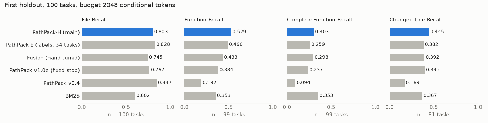

*Figure 1. First holdout, budget 2048: four metrics for six methods. The variant chosen before the run is in blue.*

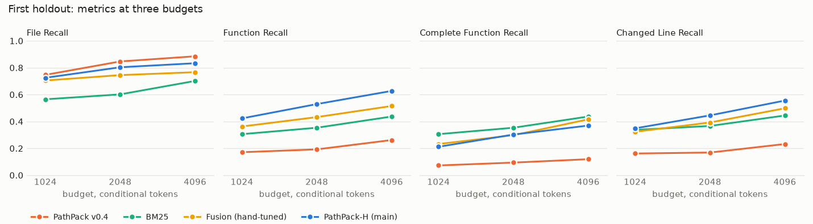

*Figure 2. First holdout: metrics at budgets of 1024, 2048, and 4096.*

Coverage of functions and lines by v0.4 hardly grows with the budget. BM25 is above PathPack-H on Complete Function Recall at all three budgets.

Comparisons stated before the run. The first interval is over tasks, the second over repositories (9 clusters).

| Comparison | Metric | Difference | 95% CI over tasks | 95% CI over repositories | Wins / ties / losses |
|---|---|---:|---|---|---|
| H − v0.4 | File | −0.043 | [−0.102, +0.017] | [−0.167, +0.019] | 4 / 85 / 11 |
| H − v0.4 | Function | +0.337 | [+0.235, +0.442] | [+0.095, +0.404] | 42 / 52 / 5 |
| H − v0.4 | Complete | +0.209 | [+0.122, +0.301] | [+0.034, +0.263] | 27 / 68 / 4 |
| H − v0.4 | Changed Line | +0.277 | [+0.168, +0.386] | [+0.049, +0.334] | 34 / 41 / 6 |
| H − fusion | File | +0.058 | [−0.000, +0.123] | [−0.018, +0.127] | 10 / 87 / 3 |
| H − fusion | Function | +0.097 | [+0.029, +0.176] | [+0.000, +0.219] | 14 / 81 / 4 |
| H − fusion | Complete | +0.005 | [−0.052, +0.069] | [−0.045, +0.096] | 6 / 87 / 6 |
| H − fusion | Changed Line | +0.053 | [−0.018, +0.129] | [−0.024, +0.174] | 13 / 61 / 7 |

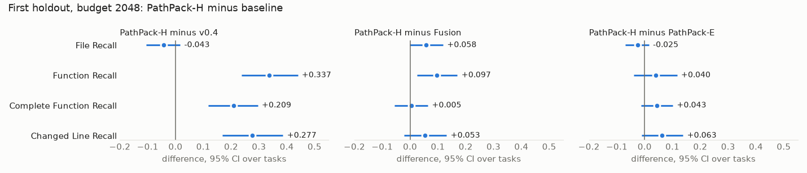

*Figure 3. First holdout, budget 2048: the difference "PathPack-H minus baseline" with a 95% interval from the paired bootstrap over tasks.*

PathPack-H is above v0.4 on Function, Complete, and Changed Line under both bootstrap procedures. On File the difference is −0.043, and the interval includes zero. Against fusion, only Function Recall is significant, and under the bootstrap over repositories the lower bound of its interval is zero.

Secondary comparisons over tasks. H minus E: File −0.025 [−0.065, +0.015], Function +0.040 [−0.037, +0.115], Complete +0.043 [−0.014, +0.105], Changed Line +0.063 [−0.009, +0.134]. For H minus H without the graph round, all four intervals include zero. Fusion minus v0.4: File −0.102 [−0.173, −0.032], and the other three metrics are above zero (+0.240, +0.204, +0.224). v1.0e minus v0.4: File −0.080 [−0.152, −0.012], and the other three are above zero.

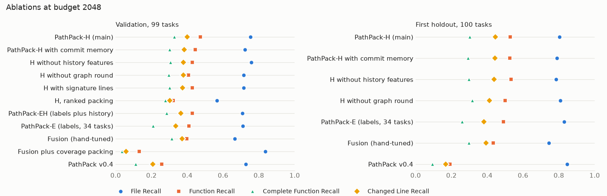

*Figure 4. Ablations at budget 2048: validation on the left, first holdout on the right.*

A PathPack-H query takes about 0.42 seconds with a prebuilt index. Building the embedding index of 4096 UniXcoder fragments takes several minutes per task.

### 6.5 PathPack-U

#### Validation

PathPack-U was developed after validation had already been used to choose the PathPack-H variant. The numbers below serve as a check before the held-out set, and they are not an independent evaluation.

| Method | File | Function | Complete | Changed Line | Insertion Anchor |
|---|---:|---:|---:|---:|---:|
| BM25 | 0.469 | 0.295 | 0.295 | 0.259 | 0.213 |
| PathPack v0.4 | 0.728 | 0.258 | 0.112 | 0.207 | 0.145 |
| Fusion | 0.665 | 0.396 | 0.315 | 0.371 | 0.289 |
| PathPack-H | 0.752 | 0.474 | 0.329 | 0.399 | 0.251 |
| PathPack-U | 0.854 | 0.439 | 0.351 | 0.380 | 0.316 |
| U without the whole-function move | 0.844 | 0.445 | 0.316 | 0.373 | 0.313 |

At a budget of 1024, U gets File 0.828, Function 0.324, Complete 0.212, and Changed Line 0.244, while H gets 0.688, 0.324, 0.179, and 0.257. At a budget of 4096, U gets 0.860, 0.469, 0.404, and 0.428, while H gets 0.767, 0.555, 0.390, and 0.460.

| Comparison | File | Function | Complete | Changed Line |
|---|---|---|---|---|
| U − v0.4 | +0.126 [+0.047, +0.207], 17/76/6 | +0.181 [+0.088, +0.274], 25/61/3 | +0.240 [+0.163, +0.327], 28/61/0 | +0.173 [+0.098, +0.255], 22/55/1 |
| U − H | +0.102 [+0.049, +0.165], 12/87/0 | −0.036 [−0.109, +0.039], 5/73/11 | +0.022 [−0.039, +0.090], 7/78/4 | −0.019 [−0.082, +0.042], 6/62/10 |
| U − BM25 | +0.385 [+0.293, +0.478] | +0.143 [+0.054, +0.233] | +0.056 [−0.034, +0.152], 19/59/11 | +0.121 [+0.037, +0.207] |
| U − U without the move | +0.010 [0.000, +0.030] | −0.007 [−0.040, +0.020] | +0.035 [−0.001, +0.081], 5/81/3 | +0.007 [−0.006, +0.028] |

U is above v0.4 on all four metrics, including File Recall. None of our earlier variants achieved this. Compared with PathPack-H, it adds files (+0.102 with not a single loss), and there are no differences on Function, Complete, or Changed Line. At a budget of 4096, U has lower Function Recall than H (0.469 against 0.555). The whole-function move has little effect on validation.

#### Second holdout

Two hypotheses were stated before the run. The first: U is above v0.4 on Function, Complete, and Changed Line, and not lower on File. The second: U is above PathPack-H on File. A superiority of U over H on other metrics was not claimed, because validation did not show one.

The hash of the source after the run matched the recorded value, and the audit of budgets passed. Function and Complete are defined on 42 tasks, Changed Line on 38.

| Method | Budget | File | Function | Complete | Changed Line | Insertion Anchor |
|---|---:|---:|---:|---:|---:|---:|
| BM25 | 2048 | 0.588 | 0.365 | 0.365 | 0.346 | 0.190 |
| PathPack v0.4 | 2048 | 0.735 | 0.252 | 0.145 | 0.229 | 0.111 |
| Fusion | 2048 | 0.775 | 0.536 | 0.397 | 0.494 | 0.376 |
| PathPack-H | 2048 | 0.775 | 0.520 | 0.310 | 0.469 | 0.264 |
| PathPack-U | 2048 | 0.863 | 0.508 | 0.417 | 0.414 | 0.329 |
| U without the whole-function move | 2048 | 0.863 | 0.508 | 0.333 | 0.407 | 0.319 |
| PathPack v0.4 | 1024 | 0.618 | 0.157 | 0.073 | 0.173 | 0.048 |
| PathPack-H | 1024 | 0.755 | 0.385 | 0.226 | 0.294 | 0.252 |
| PathPack-U | 1024 | 0.863 | 0.411 | 0.315 | 0.345 | 0.214 |
| PathPack v0.4 | 4096 | 0.892 | 0.339 | 0.232 | 0.308 | 0.219 |
| PathPack-H | 4096 | 0.814 | 0.609 | 0.514 | 0.534 | 0.309 |
| PathPack-U | 4096 | 0.863 | 0.667 | 0.575 | 0.559 | 0.409 |

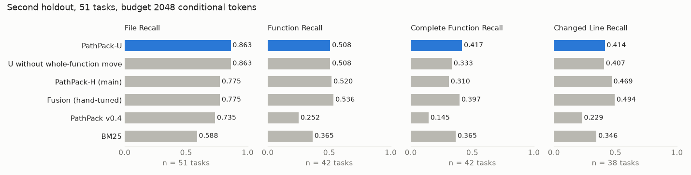

*Figure 5. Second holdout, budget 2048: four metrics for six methods.*

| Comparison | Metric | Difference | 95% CI over tasks | 95% CI over repositories | Wins / ties / losses |
|---|---|---:|---|---|---|
| U − v0.4 | File | +0.127 | [+0.029, +0.235] | [−0.045, +0.274] | 8 / 42 / 1 |
| U − v0.4 | Function | +0.256 | [+0.141, +0.381] | [+0.060, +0.360] | 14 / 28 / 0 |
| U − v0.4 | Complete | +0.272 | [+0.153, +0.403] | [+0.036, +0.388] | 14 / 28 / 0 |
| U − v0.4 | Changed Line | +0.185 | [+0.071, +0.308] | [−0.015, +0.303] | 11 / 25 / 2 |
| U − H | File | +0.088 | [+0.020, +0.167] | [0.000, +0.241] | 5 / 46 / 0 |
| U − H | Function | −0.012 | [−0.119, +0.095] | [−0.158, +0.033] | 3 / 36 / 3 |
| U − H | Complete | +0.107 | [+0.024, +0.214] | [0.000, +0.159] | 5 / 37 / 0 |
| U − H | Changed Line | −0.055 | [−0.150, +0.043] | [−0.160, −0.017] | 3 / 30 / 5 |
| U − fusion | File | +0.088 | [+0.020, +0.167] | [0.000, +0.119] | 5 / 46 / 0 |
| U − fusion | Function | −0.028 | [−0.175, +0.119] | [−0.261, +0.054] | 5 / 30 / 7 |
| U − fusion | Complete | +0.020 | [−0.127, +0.167] | [−0.263, +0.126] | 6 / 30 / 6 |
| U − fusion | Changed Line | −0.080 | [−0.252, +0.091] | [−0.306, −0.005] | 6 / 24 / 8 |
| U − U without the move | Complete | +0.083 | [+0.012, +0.179] | [0.000, +0.122] | 4 / 38 / 0 |

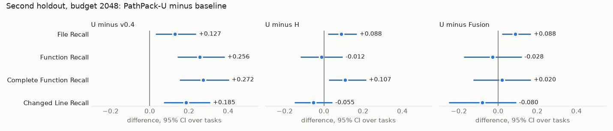

*Figure 6. Second holdout, budget 2048: PathPack-U minus baseline, with a 95% interval over tasks.*

The first hypothesis is confirmed under the bootstrap over tasks: U is above v0.4 on all four metrics. Under the bootstrap over repositories, the intervals for Function and Complete stay above zero, while for File and Changed Line they include zero. The second hypothesis is confirmed under the bootstrap over tasks (+0.088 with no losses), and under the bootstrap over repositories its lower bound is zero.

The following observations were not stated in advance. U is above PathPack-H on Complete Function Recall by 0.107, and this gain comes from the whole-function move: without it, Complete falls from 0.417 to 0.333 with the other metrics unchanged. On validation the same effect was weaker (+0.035). On Changed Line Recall, U is below PathPack-H and fusion by point estimates, and under the bootstrap over repositories both intervals lie below zero. On this set, manual fusion is no worse than the trained variants on Function and Changed Line. BM25 is significantly below U only on File (+0.275 [+0.157, +0.392]). On Function, Complete, and Changed Line, the intervals of the difference with BM25 include zero.

A query of U took 0.34 seconds in this run, the same as H. On validation the measured latency of U was about 1.2 seconds, but that run shared the machine with other computations, so the two measurements cannot be compared.

### 6.6 Third holdout: 125 tasks, unseen repositories, and the parts of PathPack-U

The second holdout is small, and the history used for training and the tasks used for evaluation came from the same repositories. The third held-out set closes both gaps. It contains 125 tasks of the train pool that were never retrieved or evaluated before: 84 from django, 23 from sympy, 9 from sphinx, 5 from matplotlib, and 4 from scikit-learn. The manifest was written before any measurement.

Three hypotheses were stated before the run. The first: U is above v0.4 on all four metrics. The second: U is above PathPack-H on File and Complete. The third: models trained without the history of the task's own repository are above v0.4 on Function, Complete, and Changed Line. The hash of the source after the run matched the recorded value, and the audit of budgets passed. Function and Complete are defined on 106 tasks, Changed Line on 99.

| Method | Budget | File | Function | Complete | Changed Line | Insertion Anchor |
|---|---:|---:|---:|---:|---:|---:|
| BM25 | 2048 | 0.465 | 0.358 | 0.358 | 0.328 | 0.154 |
| PathPack v0.4 | 2048 | 0.649 | 0.186 | 0.115 | 0.156 | 0.040 |
| Fusion | 2048 | 0.645 | 0.433 | 0.317 | 0.368 | 0.154 |
| PathPack-H | 2048 | 0.635 | 0.448 | 0.255 | 0.385 | 0.207 |
| PathPack-U | 2048 | 0.765 | 0.419 | 0.340 | 0.352 | 0.157 |
| U without the whole-function move | 2048 | 0.761 | 0.425 | 0.284 | 0.349 | 0.157 |
| U with noisy-OR instead of the trained levels | 2048 | 0.765 | 0.421 | 0.319 | 0.342 | 0.112 |
| PathPack-H without the task's own repository history | 2048 | 0.639 | 0.443 | 0.259 | 0.368 | 0.234 |
| PathPack-U without the task's own repository history | 2048 | 0.757 | 0.427 | 0.335 | 0.352 | 0.197 |
| PathPack v0.4 | 1024 | 0.571 | 0.141 | 0.102 | 0.135 | 0.022 |
| PathPack-H | 1024 | 0.607 | 0.366 | 0.198 | 0.286 | 0.166 |
| PathPack-U | 1024 | 0.737 | 0.322 | 0.240 | 0.282 | 0.102 |
| PathPack v0.4 | 4096 | 0.764 | 0.245 | 0.153 | 0.194 | 0.040 |
| PathPack-H | 4096 | 0.679 | 0.543 | 0.368 | 0.471 | 0.259 |
| PathPack-U | 4096 | 0.786 | 0.543 | 0.469 | 0.460 | 0.233 |

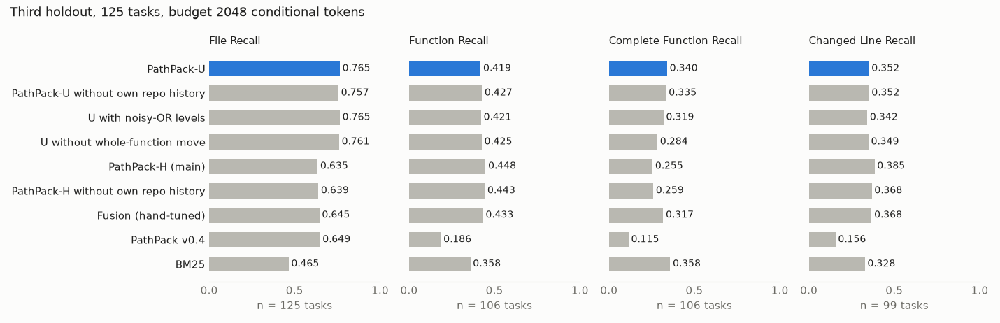

*Figure 7. Third holdout, budget 2048: four metrics for nine variants.*

#### Stated comparisons

The first interval is over tasks, the second over repositories (5 clusters).

| Comparison | Metric | Difference | 95% CI over tasks | 95% CI over repositories | Wins / ties / losses |
|---|---|---:|---|---|---|
| U − v0.4 | File | +0.116 | [+0.056, +0.180] | [+0.100, +0.222] | 18 / 105 / 2 |
| U − v0.4 | Function | +0.233 | [+0.143, +0.319] | [+0.167, +0.306] | 35 / 67 / 4 |
| U − v0.4 | Complete | +0.226 | [+0.156, +0.301] | [+0.135, +0.251] | 29 / 77 / 0 |
| U − v0.4 | Changed Line | +0.196 | [+0.112, +0.285] | [+0.087, +0.231] | 31 / 61 / 7 |
| U − H | File | +0.130 | [+0.078, +0.187] | [+0.016, +0.147] | 20 / 105 / 0 |
| U − H | Complete | +0.085 | [+0.025, +0.149] | [+0.029, +0.114] | 16 / 86 / 4 |
| U − H | Function | −0.029 | [−0.109, +0.050] | [−0.053, +0.069] | 12 / 78 / 16 |
| U − H | Changed Line | −0.033 | [−0.114, +0.046] | [−0.071, +0.017] | 12 / 69 / 18 |

The first hypothesis is confirmed: U is above v0.4 on all four metrics, and all eight intervals lie above zero. The second is confirmed: U is above PathPack-H on File (with no losses) and on Complete under both ways of computing the interval. On Function and Changed Line, U and H cannot be told apart.

On this set, PathPack-H against v0.4 repeats the result of the first holdout: Function +0.262 [+0.176, +0.349], Complete +0.141 [+0.073, +0.209], Changed Line +0.229 [+0.148, +0.315], File −0.014 [−0.080, +0.048].

#### Unseen repositories

For each of the five repositories in the set, the fragment model and the function and file models were retrained on the pseudo-tasks of the other eleven repositories. Tasks of a repository are scored by a model that has not seen its history. The features of the repository's own history remain available at the application stage.

| Comparison | File | Function | Complete | Changed Line |
|---|---|---|---|---|
| U without own history − v0.4 | +0.108 [+0.048, +0.168] | +0.240 [+0.151, +0.330] | +0.220 [+0.151, +0.296] | +0.196 [+0.114, +0.286] |
| H without own history − v0.4 | −0.010 [−0.070, +0.054] | +0.257 [+0.183, +0.343] | +0.145 [+0.085, +0.212] | +0.212 [+0.138, +0.292] |
| U without own history − U | −0.008 [−0.040, +0.016] | +0.008 [−0.025, +0.045] | −0.006 [−0.035, +0.024] | 0.000 [−0.036, +0.040] |
| H without own history − H | +0.004 [−0.040, +0.048] | −0.005 [−0.045, +0.033] | +0.004 [−0.046, +0.054] | −0.016 [−0.052, +0.021] |

The third hypothesis is confirmed. Both models without the history of their own repository are above v0.4 on Function, Complete, and Changed Line, and U is also above v0.4 on File. The difference between the model without its own history and the model with it does not exceed 0.016 in absolute value, and all eight intervals include zero. On 99 of the 106 tasks with a defined Function Recall, the two U variants agree. Training on history does not memorize a specific repository: a model trained on other projects works the same way.

A caveat: the set contains five repositories, all from SWE-bench and all written in Python. Transfer to a project of a different kind was not tested in this experiment.

#### What the parts of PathPack-U contribute

| Comparison | File | Function | Complete | Changed Line |
|---|---|---|---|---|
| U − U with noisy-OR | 0.000 [0.000, 0.000] | −0.002 [−0.067, +0.061] | +0.021 [−0.028, +0.073] | +0.010 [−0.043, +0.062] |
| U − U without the whole-function move | +0.004 [0.000, +0.012] | −0.006 [−0.044, +0.028] | +0.057 [+0.018, +0.104] | +0.003 [−0.030, +0.038] |
| U − fusion | +0.120 [+0.062, +0.184] | −0.014 [−0.084, +0.054] | +0.023 [−0.036, +0.085] | −0.016 [−0.079, +0.051] |
| U − BM25 | +0.300 [+0.221, +0.378] | +0.060 [−0.037, +0.155] | −0.018 [−0.115, +0.076] | +0.024 [−0.066, +0.113] |

The two trained models of the function and file levels contribute nothing. The variant in which these probabilities are computed by a plain noisy-OR over fragment probabilities is indistinguishable from the full variant on all four metrics. The gain of U over H on files comes from the packing objective itself, which has explicit terms for files and functions. The whole-function move adds 0.057 to Complete Function Recall, and its interval over tasks lies above zero. This agrees with the second holdout.

Over fusion, U wins only on File. Over BM25 it also wins only on File, and on Complete Function Recall BM25 is no worse on this set (0.358 against 0.340).

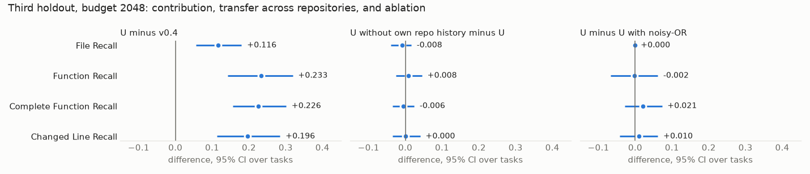

*Figure 8. Third holdout, budget 2048: U minus v0.4, U without its own repository history minus U, and U minus U with noisy-OR. The 95% interval is over tasks.*

### 6.7 Static test bridge

We checked one more channel. The task text was matched with existing test functions by BM25 (the name and the body of the test), and the score was passed along static graph edges from the test to the production code that the test calls, inherits from, or imports. IssueExec and Issue-Test-Localizer build such a bridge from execution traces and coverage. Our variant does not run the tests.

The probe ran on 22 train-pool tasks, 16 of them with positive examples. The features of the bridge do not separate edited fragments from the rest: AUC is 0.496 at the function level, 0.517 at the class level, and 0.510 at the file level over the whole pool, and 0.50 inside the needed files. The lexical score on the same tasks gives 0.811 and 0.731. In matplotlib, no static edges from tests to code were found at all. The channel is not included in the algorithm.

### 6.8 Localization by Gemma 4 from the packed context

The metrics above show that the needed code entered the context. They do not show whether a small model can use it. We tested this with the local Gemma 4 model (`gemma4:e2b-mlx` in Ollama, temperature 0, seed 0, an 8192-token window). The model receives the task text and the context of a method at 2048 conditional tokens, and it names one function that should be edited, in JSON. An answer counts as a file hit if the named file is in the reference patch, and as a function hit if the named function in that file is changed by the patch. The plan of comparisons was recorded before the answers were scored (`output/llm_probe/PLAN.json`). All 1280 answers were valid JSON.

The contexts come from the held-out runs that were already completed, and the model's answers were not evaluated before. PathPack-U was not run on the first holdout set, so it is absent there. The third set was added to the plan before any answers were generated for it.

| Set | Method | Correct file named | Correct function named |
|---|---|---:|---:|
| first holdout, 100 tasks | BM25 | 0.560 | 0.354 |
| | PathPack v0.4 | 0.660 | 0.364 |
| | Fusion | 0.700 | 0.434 |
| | PathPack-H | 0.710 | 0.505 |
| second holdout, 51 tasks | BM25 | 0.569 | 0.286 |
| | PathPack v0.4 | 0.647 | 0.500 |
| | Fusion | 0.706 | 0.429 |
| | PathPack-H | 0.706 | 0.500 |
| | PathPack-U | 0.804 | 0.524 |
| third holdout, 125 tasks | BM25 | 0.416 | 0.358 |
| | PathPack v0.4 | 0.432 | 0.264 |
| | Fusion | 0.536 | 0.358 |
| | PathPack-H | 0.544 | 0.406 |
| | PathPack-U | 0.568 | 0.377 |

The function accuracy is computed on 99 tasks of the first set, 42 tasks of the second, and 106 tasks of the third.

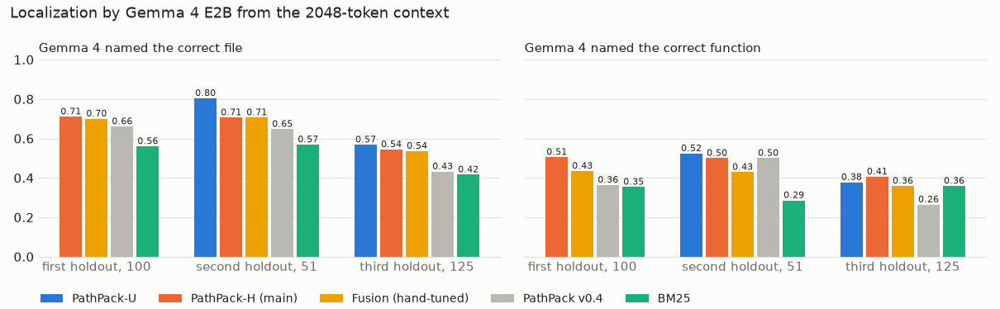

*Figure 9. Share of tasks in which Gemma 4 E2B correctly named the file and the function to edit, across the three held-out sets.*

Difference from v0.4, with a 95% interval from the paired bootstrap over tasks, and the counts of wins, ties, and losses:

| Set | Comparison | File | Function |
|---|---|---|---|
| first | H − v0.4 | +0.050 [−0.040, +0.140], 12/81/7 | +0.141 [+0.040, +0.242], 22/69/8 |
| first | fusion − v0.4 | +0.040 [−0.050, +0.130], 12/80/8 | +0.071 [−0.040, +0.182], 20/66/13 |
| first | BM25 − v0.4 | −0.100 [−0.190, −0.010], 5/80/15 | −0.010 [−0.121, +0.101], 15/68/16 |
| second | U − v0.4 | +0.157 [+0.059, +0.255], 8/43/0 | +0.024 [−0.143, +0.190], 7/29/6 |
| second | H − v0.4 | +0.059 [−0.059, +0.196], 7/40/4 | 0.000 [−0.167, +0.190], 7/28/7 |
| second | fusion − v0.4 | +0.059 [−0.078, +0.196], 8/38/5 | −0.071 [−0.262, +0.119], 7/25/10 |
| second | BM25 − v0.4 | −0.078 [−0.196, +0.039], 3/41/7 | −0.214 [−0.381, −0.024], 4/25/13 |
| third | U − v0.4 | +0.136 [+0.064, +0.216], 22/98/5 | +0.113 [+0.019, +0.208], 19/80/7 |
| third | H − v0.4 | +0.112 [+0.032, +0.200], 21/97/7 | +0.142 [+0.047, +0.236], 21/79/6 |
| third | fusion − v0.4 | +0.104 [+0.024, +0.184], 21/96/8 | +0.094 [0.000, +0.179], 18/80/8 |
| third | BM25 − v0.4 | −0.016 [−0.096, +0.064], 11/101/13 | +0.094 [0.000, +0.198], 20/76/10 |

On the first holdout set, Gemma with the PathPack-H context names the needed function in 50.5% of the tasks, against 36.4% with the v0.4 context, and the interval of the difference lies above zero. On the second holdout set, with the PathPack-U context, the model more often names the needed file (0.804 against 0.647, with no losses), but there is no difference on function: v0.4 gives 0.500 on this set. The function gain seen on the first set did not repeat on the second.

On the third holdout set, the largest and the one not touched before, both methods are above v0.4 on both measures, and all four intervals lie above zero. With the PathPack-H context the model names the function correctly in 40.6% of the tasks, against 26.4%, and with the PathPack-U context in 37.7%. Among U, H, and fusion, this probe does not distinguish them: U minus H gives +0.024 [−0.040, +0.088] on file and −0.028 [−0.113, +0.057] on function.

Summary over the three sets. The PathPack-H context raises Gemma's function accuracy on two of the three sets. The PathPack-U context raises file accuracy on both sets where it was run, and function accuracy on one of the two.

The probe measures localization by the model. No patch was generated and no tests were run, so the probe says nothing about the share of fixed bugs. One model and one prompt template were tested.

## 7. Discussion

On held-out data, the following is confirmed. PathPack-H is above v0.4 on Function, Complete, and Changed Line under both bootstrap procedures, while File Recall stays within the interval. PathPack-U is above v0.4 on all four metrics on the second and third sets, and above PathPack-H on File Recall, and on the third set also on Complete Function Recall. Models trained without the history of the task's repository do not differ from the ordinary ones.

The following is not confirmed. The superiority of the trained model over manual fusion is limited to Function Recall on the first holdout set, and on the second set fusion is no worse on Function and Changed Line. The history-trained model and the label-trained model cannot be told apart, and E was trained on only 34 tasks, so what follows is only that the two sources are interchangeable in this regime. Commit memory, history features, signature lines, and the test bridge gave no contribution. The contribution of the graph round lies within the noise. The trained function and file models in PathPack-U are no better than noisy-OR.

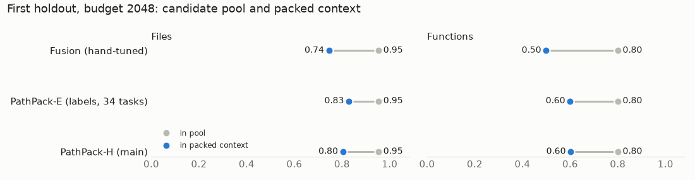

*Figure 10. First holdout, budget 2048: the share of needed files and functions in the candidate pool and in the packed context.*

The pool contains 0.95 of the needed files and 0.80 of the needed functions. PathPack-H puts 0.80 of the files and 0.60 of the functions into the context, and fusion 0.74 and 0.50. The slack remains at the selection step.

PathPack-U changes how the budget is spent. Relative to v0.4, all four metrics grow together on validation and on the second holdout set. Relative to PathPack-H, the selection changes differently: there are more files and whole functions, the number of functions above the 20% threshold is the same, and the number of lines by point estimate is smaller. U did not get better at telling apart the functions inside the right file. Neither the packing nor the additional signals that we tested improved this ability.

On the first holdout set, BM25 is above PathPack-H on Complete Function Recall at all budgets (0.353 against 0.303 at 2048), because it puts whole functions into the context. On the second holdout set, PathPack-U with the whole-function move is above BM25 by point estimate (0.417 against 0.365), but the interval of the difference includes zero.

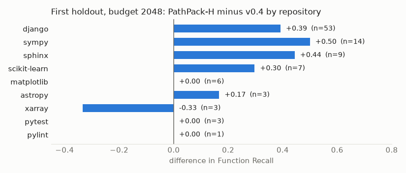

*Figure 11. First holdout, budget 2048: the difference in Function Recall "PathPack-H minus v0.4" by repository, with the number of tasks.*

The gain of H over v0.4 on Function is concentrated in django (+0.39), sympy (+0.50), sphinx (+0.44), and scikit-learn (+0.30). On xarray, H is worse on three tasks. On matplotlib, pytest, and pylint there is no difference on Function. The repositories with 1 to 6 tasks give conclusions that are unreliable.

On the new tasks, v0.4 loses to BM25 on Function, Complete, and Changed Line. On the 20 diagnostic tasks it was the best on File Recall, and it remained our main method. A small set that was used many times led to a method that covers files well and functions poorly.

## 8. Limitations

- The sets are small. Validation has 99 tasks, the first holdout set 100, and the second 51. Under the bootstrap over repositories there are 9 clusters, and django accounts for 54 of the 100 tasks in the first holdout set and for 27 of the 51 in the second.
- Validation was used twice: to choose the PathPack-H variant and to check PathPack-U.
- The main PathPack-H variant was chosen as the best of several on validation. The ablations on the held-out sets are a secondary analysis without a correction for multiple comparisons.
- Transfer was tested only within the 12 SWE-bench repositories: the model was trained on eleven and evaluated on the twelfth, and five repositories took part in the evaluation. All of them are written in Python and are similar in structure. A project of another kind was not tested.
- On the third holdout set, 84 of the 125 tasks come from django.
- The replay labels are approximate: the function is taken from the hunk header, and the code is taken from a later snapshot.
- The control on labels is weak: 34 labeled tasks.
- For 16 of the 20 diagnostic tasks, the labels are incomplete.
- The tokens are conditional. Absolute budget values do not carry over to Gemma.
- The LLM experiment is limited to localization: one model (Gemma 4 E2B), one prompt template, no patch generation, and no test runs. We did not measure the share of fixed bugs.
- Only Python was considered.
- The UniXcoder-base embeddings were not compared with SweRankEmbed. CodeT5+ did not load on the installed version of transformers.
- There is no direct comparison with CommitCompass or SweRank, and their metrics are different.

## 9. Reproducibility

Repository: https://github.com/ArduRadioKot/PathPack. Commit: 650744b7e49fca5283397a43d2f5a0326149ebdc. Freeze files: https://github.com/ArduRadioKot/PathPack/tree/main/output/pathpack_e. Splits and manifests: https://github.com/ArduRadioKot/PathPack/tree/main/output/pathpack_r_splits_v2. Notebook with tables and figures: https://github.com/ArduRadioKot/PathPack/blob/main/notebooks/11_pathpack_h.ipynb. Run summaries: https://github.com/ArduRadioKot/PathPack/tree/main/output.

```bash
# splits (frozen)
output/pathpack_r_splits_v2/manifest.json
output/pathpack_r_splits_v2/final_holdout_100_manifest.json
output/pathpack_r_splits_v2/final_holdout2_manifest.json

# diagnostics
PYTHONPATH=src python -m codegraph_rag.pathpack_r benchmark --out output/pathpack_r_diag --split dev
PYTHONPATH=src python -m codegraph_rag.pathpack_r score --out output/pathpack_r_diag

# PathPack-H: commit logs, pseudo-tasks, training, validation, first holdout set
PYTHONPATH=src python -m codegraph_rag.pathpack_r.history_replay fetch
PYTHONPATH=src python -m codegraph_rag.pathpack_r.history_replay build
sh output/pathpack_e/chain_val.sh
output/pathpack_e/FREEZE_before_holdout.json
output/pathpack_holdout/

# PathPack-U: function and file models, validation, second holdout set
PYTHONPATH=src python -m codegraph_rag.pathpack_r.hier_model --exclude output/pathpack_r_splits_v2/validation_issues.jsonl output/pathpack_r_splits_v2/final_holdout_issues.jsonl output/benchmark/issues.jsonl
output/pathpack_e/FREEZE_before_holdout2.json
output/pathpack_holdout2/

# third holdout set and models without the task's repository
PYTHONPATH=src python scripts/fit_loro.py django/django   # and likewise for each repository of the set
sh output/pathpack_e/chain_h3.sh
output/pathpack_e/FREEZE_before_holdout3.json
output/pathpack_holdout3/  output/pathpack_holdout3_loro/

# PathPack-E (train pool only)
PYTHONPATH=src python -m codegraph_rag.pathpack_r.edit_train build --issues output/pathpack_r_splits_v2/train_110.jsonl
PYTHONPATH=src python -m codegraph_rag.pathpack_r.edit_train fit --exclude output/pathpack_r_splits_v2/validation_issues.jsonl output/pathpack_r_splits_v2/final_holdout_100_issues.jsonl

# probe of localization by Gemma 4 (requires Ollama running with gemma4:e2b-mlx)
python scripts/llm_localize.py ask output/pathpack_holdout output/pathpack_r_splits_v2/final_holdout_100_issues.jsonl output/llm_probe/holdout1.jsonl 2048:999 bm25 pathpack-v4 pathpack-r/fusion pathpack-h/nomemory
PYTHONPATH=src python scripts/llm_localize.py score output/pathpack_holdout output/llm_probe/holdout1.jsonl

# probe of the test bridge
PYTHONPATH=src python scripts/probe_test_bridge.py 22
```

The tables and figures are built by `notebooks/11_pathpack_h.ipynb`, generated by `scripts/write_pathpack_h_notebook.py`, which reads the numbers from the run files. The English figures are built by `scripts/make_figures_en.py` from the same files. The tests are in `tests/test_pathpack_e.py`, `tests/test_pathpack_r.py`, and `tests/test_pathpack_v10e.py`: 33 in total, all passing. Embeddings were computed on Apple Silicon with `CODEGRAPH_DEVICE=mps`. The cosine similarity between MPS and CPU vectors on a probe of 256 fragments is not below 0.9999998.

## 10. Conclusion

A model of edit probability, trained by replaying past commits without benchmark labels, together with packing by expected coverage per token, covers on 100 held-out SWE-bench Verified tasks about 2.7 times as many changed functions and 2.6 times as many changed lines as our previous method v0.4, with comparable file coverage. Against a hand-tuned merge of the same channels the gain is modest and significant only on Function Recall.

Packing under the sum of expected metrics, on two held-out sets of 51 and 125 tasks, beats v0.4 on all four metrics, including file coverage. Compared with PathPack-H, it adds files and whole functions and does not add lines. The gain comes from the packing objective itself, and the separately trained function and file models turned out to be unnecessary.

A model trained on the history of eleven repositories works on the twelfth just as well as a model that had seen its history.

Features from history, commit memory, and the static test bridge did not help. History turned out to be useful as a source of training examples.

The local Gemma 4 model with the PathPack-H context more often names the correct function for editing on the first and third held-out sets, and with the PathPack-U context it more often names the correct file on the second and third sets and the correct function on the third. The effect on the share of fixed bugs was not measured, and this remains the main open question.

## References

The bibliographic data were checked against the arXiv pages on November 11, 2026.

- Chen Z., Tang X., Deng G., Wu F., Wu J., Jiang Z., Prasanna V., Cohan A., Wang X. LocAgent: Graph-Guided LLM Agents for Code Localization. [arXiv:2503.09089](https://arxiv.org/abs/2503.09089), 2025.
- CommitCompass. Repository [github.com/VijayChamakuri/commitcompass](https://github.com/VijayChamakuri/commitcompass), a project without peer review, viewed 11.11.2026.
- Gandhi S., Gao L., Callan J. Repository-level Code Search with Neural Retrieval Methods. [arXiv:2502.07067](https://arxiv.org/abs/2502.07067), 2025.
- IssueExec: A Test-Driven Approach for Localizing Software Engineering Issues. [arXiv:2607.17286](https://arxiv.org/abs/2607.17286), 2026. Authors and details not checked against the full text.
- Issue-Test-Localizer. Repository [github.com/IBM/Issue-Test-Localizer](https://github.com/IBM/Issue-Test-Localizer). Only the search-result excerpt was viewed.
- Jiang Z., Ren X., Yan M., Jiang W., Li Y., Liu Z. Issue Localization via LLM-Driven Iterative Code Graph Searching (CoSIL). [arXiv:2503.22424](https://arxiv.org/abs/2503.22424). ASE 2025.
- Jimenez C. E., Yang J., Wettig A., Yao S., Pei K., Press O., Narasimhan K. SWE-bench: Can Language Models Resolve Real-World GitHub Issues? [arXiv:2310.06770](https://arxiv.org/abs/2310.06770). ICLR 2024.
- Reddy R. G., Suresh T., Doo J., Liu Y., Nguyen X. P., Zhou Y., Yavuz S., Xiong C., Ji H., Joty S. SweRank: Software Issue Localization with Code Ranking. [arXiv:2505.07849](https://arxiv.org/abs/2505.07849). ICLR 2026.
- Wang B., Xu W., Li Y., Gao M., Xie Y., Sun H., Chen D. Improving Code Localization with Repository Memory. [arXiv:2510.01003](https://arxiv.org/abs/2510.01003). ICLR 2026.
- Wen M., Wu R., Cheung S.-C. Locus: Locating Bugs from Software Changes. ASE 2016. [Preprint](https://cse.hkust.edu.hk/faculty/scc/publ/ase16-Locus-preprint.pdf).
- Xia C. S., Deng Y., Dunn S., Zhang L. Agentless: Demystifying LLM-based Software Engineering Agents. [arXiv:2407.01489](https://arxiv.org/abs/2407.01489), 2024.
- Yu Z., Zhang H., Zhao Y., Huang H., Yao M., Ding K., Zhao J. OrcaLoca: An LLM Agent Framework for Software Issue Localization. [arXiv:2502.00350](https://arxiv.org/abs/2502.00350). ICML 2025 (PMLR 267).
- Zhou J., Zhang H., Lo D. Where Should the Bugs Be Fixed? More Accurate Information Retrieval-Based Bug Localization Based on Bug Report. ICSE 2012.
- Li H. et al. ContextBench: A Benchmark for Context Retrieval in Coding Agents. [arXiv:2602.05892](https://arxiv.org/abs/2602.05892), 2026.
- Zhang S. et al. SWE-Explore: Benchmarking How Coding Agents Explore Repositories. [arXiv:2606.07297](https://arxiv.org/abs/2606.07297), 2026.
- Qin B., Xie Y. Agent Retrieval Bench: Evaluating Repository Context Retrieval for Coding Agents. [arXiv:2607.24882](https://arxiv.org/abs/2607.24882), 2026.
