# History replay и упаковка под ожидаемые метрики: локализация правок под токен-бюджетом

## Аннотация

Малая локальная языковая модель работает с коротким контекстом, поэтому поиск кода должен уместить в бюджет те функции и строки, которые придётся менять. На SWE-bench Verified мы показываем, что эвристическая упаковка находит файлы и теряет функции, причём потери возникают при выборе из пула кандидатов: на отложенных задачах в пуле лежит 0.80 нужных функций, а в контекст попадает от 0.50 до 0.60. Мы предлагаем два метода. PathPack-H оценивает вероятность правки каждого фрагмента моделью, обученной только на прошлых коммитах самих репозиториев, без меток бенчмарка, и упаковывает контекст по ожидаемому покрытию на токен. На 100 отложенных задачах при бюджете 2048 условных токенов он даёт Function Recall 0.529 против 0.192 у нашего прежнего метода v0.4, Complete Function Recall 0.303 против 0.094 и Changed Line Recall 0.445 против 0.169. Интервалы разниц лежат выше нуля, в том числе при bootstrap по репозиториям. File Recall равен 0.803 против 0.847, разница −0.043 [−0.102, +0.017]. Над ручным слиянием тех же каналов выигрыш меньше, значим только Function Recall (+0.097). PathPack-U добавляет вероятности правки функции и файла и выбирает набор фрагментов с наибольшей суммой ожидаемых метрик. На третьем отложенном наборе из 125 задач он выше v0.4 по всем четырём метрикам (File 0.765 против 0.649, Function 0.419 против 0.186, Complete 0.340 против 0.115, Changed Line 0.352 против 0.156) и выше PathPack-H по File и Complete Function Recall, а по Function и Changed Line Recall его не превосходит. Модели, обученные без истории репозитория задачи, дают те же результаты: разница не превышает 0.016. Признаки истории, память коммитов и статический тестовый мост вклада не дали. В пробе с локальной Gemma 4 E2B на третьем наборе контекст PathPack-H повышает долю задач, где модель верно называет функцию для правки, с 0.264 до 0.406, а контекст PathPack-U с 0.264 до 0.377; на втором наборе выигрыш по функции не воспроизвёлся. Обучение локализатора на истории коммитов известно на уровне файлов. Наш вклад состоит в переносе на уровень функций и строк под фиксированным бюджетом, в цели упаковки и в проверке на отложенных данных. Генерацию патчей и долю исправленных ошибок мы не измеряли.

## 1. Введение

Агент, который исправляет ошибку в репозитории, выбирает несколько тысяч токенов из сотен тысяч. Модели на ноутбуке этот выбор определяет, поместится ли нужный код вообще.

Мы рассматриваем задачу как локализацию правки под бюджетом. По тексту задачи и снимку репозитория на `base_commit` нужно выбрать набор фрагментов кода, содержащий строки, которые меняет эталонное исправление. Качество измеряется покрытием изменённых файлов, функций и строк.

Вклад работы:

1. Диагностика потерь. Мы измеряем пул кандидатов и упакованный контекст раздельно. Основная потеря происходит на упаковке (разделы 6.1 и 7).
2. Механизм сбоя. Правило «остановиться, когда все названные в задаче символы покрыты» обнуляет пользу повторного покрытия и пропускает нужный код. Исправление одной этой остановки значимо улучшает три метрики на новых задачах (раздел 6.2).
3. PathPack-H. Модель вероятности правки обучается на прошлых коммитах без меток бенчмарка, с временной защитой от утечки (раздел 4.5). Сам приём известен на уровне файлов, ближайшая работа CommitCompass (раздел 3). Мы переносим его на уровень функций и строк и на выход фиксированного токен-бюджета. На отложенных задачах модель на истории неотличима от той же модели, обученной на размеченных задачах бенчмарка, и превосходит v0.4 по функциям и строкам (раздел 6.4).
4. Упаковка по ожидаемому покрытию. Жадный выбор по вероятности правки на токен с бонусом за новый файл (раздел 4.4). Упаковка ранжированием с той же моделью теряет 0.16 File Recall, а та же упаковка с некалиброванными баллами разрушает покрытие функций (раздел 6.3).
5. PathPack-U. Цель упаковки равна сумме ожидаемых File, Function, Complete Function и Changed Line Recall с вероятностями правки на трёх уровнях (фрагмент, функция, файл). Веса цели выводятся из истории и не подбираются (раздел 4.6). Аналога такой цели в найденных работах мы не обнаружили. На двух отложенных наборах (51 и 125 задач) это единственный наш вариант, который выше v0.4 по всем четырём метрикам (разделы 6.5 и 6.6). Абляция показывает, что вклад даёт сама цель и ход «функция целиком», а две обученные модели уровня функции и файла можно заменить на noisy-OR без потерь.
6. Перенос между репозиториями. Модели, обученные без истории репозитория задачи, дают те же метрики, что и модели с ней (раздел 6.6).
7. Протокол. Замороженные сплиты на 500 задач с проверкой пересечений, три отложенных набора, bootstrap по задачам и по репозиториям, отдельная метрика для чистых вставок (раздел 5).

Мы не утверждаем превосходства над агентами-программистами. Проба с локальной Gemma 4 проверяет только локализацию моделью (раздел 6.8), генерации патчей и запуска тестов в работе нет (раздел 8).

## 2. Постановка и метрики

На входе репозиторий $R$ на `base_commit`, текст задачи $Q$ и бюджет $B$. На выходе набор фрагментов $S$ с $\mathrm{TokenCost}(S) \le B$.

Токены условные: $\lceil \text{UTF-8 bytes} / 4 \rceil$ по всему сериализованному контексту вместе с заголовками и путями. Токенизатор Gemma не использовался, пересчёт им не проводился. Все методы считаются одним счётчиком.

Эталонный патч читается только при оценке. Признаки, пул и упаковка к нему не обращаются, это проверяют тесты.

Метрики:

- File Recall: доля изменённых файлов, покрытых контекстом.
- Function Recall: доля изменённых функций, у которых покрыто не менее 20% строк тела. Совпадение имени функции покрытием не считается.
- Complete Function Recall: доля изменённых функций, покрытых целиком.
- Changed Line Recall: доля удалённых или заменённых базовых строк. Чистые вставки в неё не входят.
- Insertion Anchor Recall: для чистых вставок, доля базовых строк, между которыми вставлен код.

Для каждой метрики указано число задач, на которых она определена. Задача без значения метрики в среднее не входит и нулём не считается.

## 3. Связанные работы

Источники сверены со страницами arXiv и репозиториев 11 ноября 2026 года. HTML-версии статей прочитаны дословно примерно на первые 40 тысяч символов, ниже приведено только прочитанное.

### Обучение и поиск по истории коммитов

CommitCompass (репозиторий `VijayChamakuri/commitcompass`, без статьи и рецензирования) ближе всего к нашей работе. Это ранжировщик на градиентном бустинге по 18 признакам, обученный только на парах «сообщение коммита, изменённые файлы»: 3000 коммитов до первой задачи каждого из тех же 12 репозиториев SWE-bench, есть вариант leave-one-repo-out. Оценка идёт на 300 задачах SWE-bench Lite на уровне файла по Acc@k и MRR, заявлено Acc@1 47.7. Токен-бюджета и упаковки фрагментов в проекте нет. Авторы отмечают, что обучающие запросы у них являются сообщениями коммитов.

Gandhi, Gao и Callan (arXiv:2502.07067) используют BM25 по сообщениям коммитов и два reranker на CodeBERT, обученные на тройках из коммитов. Сообщения переписываются GPT-4 в стиль задач. Оценка идёт на уровне файла по MAP, MRR, P@k и R@k на собственном наборе из 7 репозиториев.

Wang и соавторы (arXiv:2510.01003, ICLR 2026) дают агенту BM25 по сообщениям 7000 коммитов до `base_commit` и сводки по самым часто меняемым файлам, без обучения. На SWE-bench Verified на уровне файла они сообщают Acc@1/3/5, равные 68.6, 74.5 и 76.5 с GPT-4o. Это прямой аналог нашей памяти коммитов.

IssueExec (arXiv:2607.17286, препринт 2026 года) и Issue-Test-Localizer (репозиторий IBM) используют существующие тесты как мост между задачей и кодом через трассы исполнения и покрытие. Обе работы мы знаем по выдержкам из поисковой выдачи, полный текст не читали.

Классическая IR-локализация багов использовала историю изменений задолго до LLM. BugLocator (Zhou, Zhang, Lo, ICSE 2012) ранжирует файлы по сходству с отчётом об ошибке, Locus (Wen, Wu, Cheung, ASE 2016) привлекает историю изменений.

### Локализация ранжированием и агентами

SweRank (Reddy и соавторы, arXiv:2505.07849, ICLR 2026) состоит из bi-encoder SweRankEmbed (137M и 7B параметров) и listwise-reranker SweRankLLM (7B и 32B). Модели обучены на SweLoc: пары «задача, изменённые функции» из PR 3387 репозиториев, репозитории SWE-bench исключены. Оценка идёт на SWE-bench Lite и LocBench по Acc@k на уровне файла, модуля и функции.

LocAgent (Chen и соавторы, arXiv:2503.09089) является агентом над графом кода с дообучением Qwen2.5-Coder на 768 успешных траекториях из обучающей части SWE-bench. CoSIL (Jiang и соавторы, arXiv:2503.22424, ASE 2025) ведёт итеративный поиск LLM по графу вызовов без обучения и сообщает Top-1 43.3% на Lite и 44.6% на Verified с Qwen2.5-Coder-32B. OrcaLoca (Yu и соавторы, arXiv:2502.00350, ICML 2025) использует очередь действий и обрезку контекста по расстоянию, function match rate 65.33% на Lite. Agentless (Xia и соавторы, arXiv:2407.01489) строит трёхфазный конвейер из локализации, исправления и проверки. SWE-bench (Jimenez и соавторы, arXiv:2310.06770, ICLR 2024) метрик локализации не определяет.

### Оценка контекста под бюджетом

Оценка того, что поиск даёт агентам под бюджетом, уже активно развивается. ContextBench измеряет полноту, точность и эффективность контекста по траекториям агентов на 1136 задачах [arXiv:2602.05892](https://arxiv.org/abs/2602.05892). SWE-Explore просит исследователя вернуть ранжированные регионы кода при фиксированном бюджете строк [arXiv:2606.07297](https://arxiv.org/abs/2606.07297). Agent Retrieval Bench сообщает отдачу контекста при бюджете 8K токенов для поиска на уровне файлов [arXiv:2607.24882](https://arxiv.org/abs/2607.24882). Мы не утверждаем, что бюджетная оценка контекста нова. Наш вклад: обученная модель вероятности правки и цель упаковки, оценённые на уровне функций и строк на отложенных задачах SWE-bench Verified.

### Чем наша работа отличается

Обучение локализатора на истории коммитов без меток бенчмарка уже сделано: CommitCompass использует тот же класс моделей на тех же репозиториях, а память коммитов как BM25-канал описана у Wang и соавторов. Наши отличия такие. Во-первых, метки и оценка идут на уровне функций и строк, положительные примеры берутся из заголовков ханков. Во-вторых, на выходе получается контекст фиксированного токен-бюджета, и модель используется как вероятность в цели упаковки. В-третьих, есть контроль с той же моделью, обученной на метках бенчмарка. В-четвёртых, протокол заморожен и включает два отложенных набора на SWE-bench Verified с интервалами.

Наши числа Recall под бюджетом несопоставимы с Acc@k перечисленных работ, прямое сравнение не проводилось. Память коммитов помогла Wang и соавторам и не помогла нам. Условия разные: у них это инструмент агента на уровне файлов, у нас признак модели на уровне фрагментов.

## 4. Методы

### 4.1 Базовые методы

- BM25 по фрагментам кода и отдельно по именам функций, файлов и классов.
- PathPack v0.4: BM25 по AST-чанкам, распространение релевантности по графу зависимостей на два перехода, штраф за однообразие и учёт стоимости фрагмента. Это был лучший метод на 20 диагностических задачах.
- PathPack v1.0: совместная оптимизация по свидетельствам из текста задачи с остановкой при покрытии названных символов.
- PathPack v1.0e: то же с убывающей пользой повторного покрытия (`repeat_weight 0.35`) и с допуском кандидатов, у которых есть независимый сигнал.

### 4.2 Слияние каналов (fusion)

Пул кандидатов объединяет четыре канала. Лексический канал считает BM25 по коду. Символьный ищет точные совпадения идентификаторов из текста задачи, включая CamelCase и квалифицированные имена. Семантический использует UniXcoder-base (mean pooling, ревизия `5604afdc`, косинусная близость). Структурный идёт по вызовам, импортам и наследованию на один переход. Каналы объединяются, друг друга они не фильтруют. Каждый кандидат хранит ранг в своём канале.

Балл равен $0.40\,\text{lexical} + 0.25\,\text{symbol} + 0.20\,\text{semantic} + 0.15\,\text{graph}$. Упаковка идёт по убыванию балла с порогом относительной релевантности и без остановки по покрытию символов.

### 4.3 Zero-shot reranker

Мы пробовали cross-encoder `ms-marco-MiniLM-L-6-v2`, обученный на веб-пассажах. В собственной пробе он дал 0.006 паре с совпадающим именем функции и 1e-5 несвязанной паре. Результат отрицательный (раздел 6.2), reranker оставлен только как абляция.

### 4.4 Модель вероятности правки и упаковка (PathPack-E)

Модель оценивает $p(c)$, вероятность того, что во фрагменте $c$ будет правка при данных $Q$ и $R$.

На первой стадии у фрагмента 33 признака: лексический, семантический, символьный и графовый баллы, ранги по каналам, размер фрагмента и функции, позиция фрагмента в функции, максимумы и процентили по файлу и по пулу. Шесть признаков берутся из истории до `base_commit`: частота правок файла, число коммитов-исправлений по ключевым словам в теме, совместные правки с верхними файлами пула и с файлами символьного канала, два признака памяти коммитов. История читается командой `git log` из снимка, который стоит на `base_commit`, поэтому коммита исправления в ней нет.

Вторая стадия делает один раунд распространения по рёбрам вызовов. К признакам добавляются наибольшие вероятности первой стадии среди вызывающих и вызываемых функций, по файлу и по функции. Она обучается на out-of-fold вероятностях первой стадии, сгруппированных по задаче.

Обе стадии являются градиентным бустингом (`HistGradientBoostingClassifier`, глубина 4, 200 итераций, `min_samples_leaf 40`, `l2 1.0`). PathPack-E обучается на размеченных задачах из train-pool. Перед обучением проверяется отсутствие пересечений с оценочными наборами.

Упаковка жадная по отношению $\text{gain}/\text{cost}$, где

$$\mathrm{gain}(c) = p(c)\,\bigl(1 - \mathrm{overlap}(c, \text{выбранное})\bigr) + 0.25\,p_{\text{file}}(c)\,[\text{первый фрагмент файла}]$$

Отбор останавливается, когда прирост падает ниже 0.004 или кончается бюджет. Остановки по покрытию названных символов нет.

### 4.5 PathPack-H: обучение на истории

PathPack-H использует ту же модель и ту же упаковку и обучается только на прошлых коммитах репозиториев.

Память коммитов устроена так. Темы прошлых коммитов индексируются BM25. Для новой задачи берутся 20 самых похожих коммитов, и файлы, которые они меняли, получают голос, взвешенный по сходству и делённый на число файлов коммита. Это даёт два признака первой стадии.

History replay устроен так. Для каждого репозитория берётся снимок задачи Verified с самым ранним `base_commit`. Предшествующие ему коммиты проигрываются как псевдо-задачи. Сообщение коммита служит текстом задачи. Положительными считаются фрагменты изменённого нетестового файла, чьё имя функции или класса стоит в заголовке ханка (`git log -p -U0`, драйвер `diff=python`). Коммит отбрасывается, если он меняет более 8 нетестовых файлов, если в сообщении меньше 4 различных термов или если в пуле нет ни одного положительного фрагмента.

От утечки защищают три условия. Читаются только предки самого раннего `base_commit` репозитория. Коммит должен быть старше самого раннего `created_at` среди всех задач Verified этого репозитория, поэтому ни один коммит-исправление бенчмарка в обучение не попадает. Признаки истории и память для проигрываемого коммита строятся только по строго более старым коммитам. Модуль не обращается к полю `patch` датасета, это проверяет тест.

У приёма три известных изъяна. Код берётся из снимка, поэтому функции, переименованные или удалённые после коммита, положительных примеров не дают. Сообщение коммита описывает исправление, а текст задачи описывает симптом, и величину этого сдвига показывает сравнение H с E. Часть логов недоступна в частичном клоне (`blob:none`): 47 пакетов по 20 коммитов не скачались и пропущены.

Всего получилось 1295 псевдо-задач с 12 329 положительными фрагментами, от 56 (requests) до 120 на репозиторий при потолке 120.

### 4.6 PathPack-U: упаковка под ожидаемые метрики

PathPack-H упаковывает фрагменты с одним ручным бонусом за новый файл. На первом holdout он уступил BM25 по Complete Function Recall, и пятая часть нужных функций терялась между пулом и контекстом (рис. 10). PathPack-U выбирает набор $S$ с наибольшей суммой ожидаемых значений самих метрик.

Вероятностей три. Модель фрагмента та же, что в PathPack-H. Две дополнительные модели оценивают $P(g)$, вероятность правки функции, и $P(f)$, вероятность правки файла. На вход они получают агрегаты по фрагментам своей единицы: максимум, среднее, сумму и второе по величине значение вероятности фрагмента, noisy-OR, число фрагментов в пуле, максимумы лексического, семантического, символьного и графового баллов, размер функции и процентили файла. Они обучаются на тех же псевдо-задачах, вероятности фрагментов для обучения берутся out-of-fold по пяти фолдам. Модуль обучения отказывается от любых данных, кроме history replay. Обучающих строк 127 871 на уровне функции и 47 203 на уровне файла.

Цель упаковки:

$$U(S) = w_{\text{file}} \sum_{f} P(f)\,[S \text{ касается } f] + w_{\text{fn}} \sum_{g} P(g)\,[\mathrm{cov}_g(S) \ge \theta] + w_{\text{fn}} \sum_{g} P(g)\,[\mathrm{cov}_g(S) = 1] + w_{\text{chunk}} \sum_{c} P(c)\,[c \in S]$$

Четыре слагаемых соответствуют File, Function, Complete Function и Changed Line Recall. Порог $\theta = 0.20$ совпадает с порогом покрытия в метрике Function Recall. Покрытие функции считается по токенам её фрагментов.

Веса не подбираются. Каждый равен обратному среднему числу правленых единиц на одну псевдо-задачу, поэтому каждое слагаемое является вероятностным суррогатом ожидаемого покрытия, а не точным ожидаемым recall. При оптимизации покрытие функции считается по токенам, при оценке по строкам. На псевдо-задачу в среднем приходится 1.23 правленого файла, 2.60 функции и 9.52 фрагмента, откуда $w_{\text{file}} = 0.815$, $w_{\text{fn}} = 0.384$ и $w_{\text{chunk}} = 0.105$.

Выбор жадный по приросту $U$ на токен. Ходов два вида: добавить один фрагмент или добавить все оставшиеся фрагменты одной функции. Второй ход нужен потому, что слагаемое завершения не зарабатывается ни одним отдельным фрагментом, и обычный жадный выбор его никогда не оплатит. Для 60 функций с наибольшей $P(g)$ в кандидаты добавляются их фрагменты, не попавшие в пул, с нулевой вероятностью фрагмента. Отбор останавливается по бюджету или когда положительного прироста не осталось.

Абляция `nobundle` использует ту же цель без хода «функция целиком».

## 5. Протокол

Данные взяты из SWE-bench Verified: 500 задач, снимки на точных `base_commit` получены для всех 500.

| Набор | Назначение | Размер | Где зафиксирован |
|---|---|---:|---|
| diagnostic | диагностика, использован многократно | 20 | `output/benchmark/issues.jsonl` |
| train-pool | обучение PathPack-E | 45 собрано, 34 с положительными примерами | `train_110.jsonl` |
| history replay | обучение PathPack-H и PathPack-U | 1295 псевдо-задач | `output/pathpack_e/train_history` |
| validation | выбор варианта | 99 | `validation_issues.jsonl` |
| первый holdout | оценка PathPack-H | 100 из 151 | `final_holdout_100_manifest.json` |
| второй holdout | оценка PathPack-U | остальные 51 из 151 | `final_holdout2_manifest.json` |
| третий holdout | PathPack-U, перенос между репозиториями, абляции | 125 нетронутых задач train-pool | `final_holdout3_manifest.json` |

Наборы разделены по задачам. По репозиториям они пересекаются, поэтому для основных сравнений дополнительно приведён bootstrap с кластеризацией по репозиторию. Оба манифеста отложенных наборов записаны до любых измерений на них. Обучение проверяет пересечения по `instance_id` и останавливается, если находит их.

Правило выбора варианта записано до validation. На отложенный набор идёт вариант, у которого File Recall не ниже, чем у v0.4 минус 0.05, и который выигрывает у v0.4 минимум по двум из трёх метрик (Function, Complete, Changed Line) с 95% интервалом выше нуля.

Статистика: парный bootstrap по задачам (2000 итераций, seed 42), разница «кандидат минус baseline», 95% интервал, число побед, ничьих и поражений. Для основных сравнений добавлен bootstrap по репозиториям (4000 итераций).

Перед каждым отложенным прогоном записывался файл заморозки с хэшем дерева исходников, хэшами моделей и конфигурации, основным вариантом и заявленными сравнениями. После прогона хэш исходников сверялся. Каждый отложенный набор запускался один раз.

## 6. Результаты

Все числа в этом разделе получены при бюджете 2048 условных токенов, если не указано другое.

### 6.1 Диагностика на 20 задачах

Эти 20 задач многократно использовались при разработке ранних версий, независимой оценкой они не являются.

| Метод | File | Function | Complete | Changed Line | Загрузка бюджета |
|---|---:|---:|---:|---:|---:|
| BM25 | 0.350 | 0.111 | 0.111 | 0.143 | 0.995 |
| PathPack v0.4 | 0.725 | 0.202 | 0.091 | 0.148 | 0.992 |
| PathPack v1.0 | 0.475 | 0.171 | 0.060 | 0.077 | 0.348 |
| PathPack v1.0e | 0.700 | 0.250 | 0.083 | 0.238 | 0.808 |
| Fusion | 0.650 | 0.234 | 0.234 | 0.293 | 0.951 |
| Fusion + reranker | 0.625 | 0.250 | 0.083 | 0.333 | 0.473 |

У варианта с reranker и активным расширением доля нужных файлов в пуле равна 0.90, а в упакованном контексте 0.525. Для функций это 0.667 и 0.278. Кандидаты найдены, теряются они при выборе.

У v1.0 причина потери видна на задаче `django__django-12276`. Текст называет `FileInput`, `ClearableFileInput` и `use_required_attribute`. Когда эти символы покрыты, польза новых фрагментов обнуляется, и v1.0 останавливается на двух фрагментах одного файла, заняв 127 токенов из 2048. v0.4 на той же задаче занимает 12 файлов и 2005 токенов.

### 6.2 Базовые методы на 99 новых задачах

Задачи validation при разработке базовых методов не использовались. Function и Complete определены на 89 задачах, Changed Line на 78.

| Метод | File | Function | Complete | Changed Line | Insertion Anchor | Загрузка |
|---|---:|---:|---:|---:|---:|---:|
| BM25 | 0.469 | 0.295 | 0.295 | 0.259 | 0.213 | 0.995 |
| PathPack v0.4 | 0.728 | 0.258 | 0.112 | 0.207 | 0.145 | 0.993 |
| PathPack v1.0e | 0.712 | 0.370 | 0.202 | 0.329 | 0.272 | 0.835 |
| Fusion + reranker + active | 0.575 | 0.243 | 0.156 | 0.211 | 0.160 | 0.675 |
| Fusion + reranker + граф | 0.625 | 0.270 | 0.201 | 0.250 | 0.160 | 0.682 |
| Fusion | 0.665 | 0.396 | 0.315 | 0.371 | 0.289 | 0.949 |

Разница с v0.4, 95% интервал по задачам и счёт побед, ничьих и поражений:

| Кандидат | File | Function | Complete | Changed Line |
|---|---|---|---|---|
| Fusion | −0.063 [−0.140, +0.011], 5/79/15 | +0.138 [+0.050, +0.227], 23/60/6 | +0.203 [+0.123, +0.289], 24/63/2 | +0.164 [+0.079, +0.249], 22/51/5 |
| v1.0e | −0.016 [−0.101, +0.066], 8/79/12 | +0.112 [+0.019, +0.206], 19/62/8 | +0.091 [+0.012, +0.169], 12/73/4 | +0.122 [+0.036, +0.218], 17/56/5 |
| BM25 | −0.259 [−0.355, −0.170], 3/63/33 | +0.037 [−0.053, +0.126] | +0.184 [+0.094, +0.279] | +0.052 [−0.032, +0.135] |

Fusion выше v0.4 по Function, Complete и Changed Line с интервалами выше нуля. По File его точечная оценка ниже на 0.063, интервал включает ноль. Reranker MS-MARCO ухудшает fusion по всем четырём метрикам. v0.4 уступает простому BM25 по Complete Function Recall: ширина по файлам куплена полнотой функций. Исправление одной только остановки (v1.0e) даёт значимый выигрыш над v0.4 по трём метрикам без потери File.

По правилу выбора v1.0e проходит. Fusion формально не проходит порог по File (−0.063 при допуске −0.05), хотя по остальным метрикам он сильнее.

### 6.3 PathPack-E и PathPack-H на validation

PathPack-E обучен на 34 размеченных задачах с 57 положительными фрагментами. PathPack-H обучен на 1295 псевдо-задачах.

| Метод | File | Function | Complete | Changed Line |
|---|---:|---:|---:|---:|
| PathPack v0.4 | 0.728 | 0.258 | 0.112 | 0.207 |
| Fusion | 0.665 | 0.396 | 0.315 | 0.371 |
| PathPack-E (метки) | 0.710 | 0.408 | 0.211 | 0.335 |
| PathPack-EH (метки и история) | 0.707 | 0.427 | 0.286 | 0.363 |
| PathPack-H | 0.722 | 0.444 | 0.303 | 0.383 |
| H без памяти коммитов | 0.752 | 0.474 | 0.329 | 0.399 |
| H без признаков истории | 0.757 | 0.429 | 0.306 | 0.379 |
| H без графового раунда | 0.714 | 0.406 | 0.298 | 0.379 |
| H со строками сигнатур | 0.715 | 0.427 | 0.303 | 0.374 |
| H, упаковка ранжированием | 0.565 | 0.321 | 0.279 | 0.303 |
| Fusion с упаковкой по покрытию | 0.835 | 0.130 | 0.038 | 0.057 |

По правилу выбора проходят E, EH, H и все абляции H, кроме упаковки ранжированием. Основным вариантом для первого holdout выбран H без памяти коммитов, у него лучшие точечные оценки среди вариантов на истории. Выбор сделан по validation и записан в файл заморозки до прогона. Дальше «PathPack-H» означает этот вариант.

Память коммитов не помогла: вариант без неё не хуже. Остальные признаки истории и дешёвые строки сигнатур различимого вклада не дали. Упаковка ранжированием с той же моделью теряет File Recall (−0.163 к v0.4, интервал [−0.264, −0.069]). Упаковка по покрытию с баллами fusion вместо вероятностей поднимает File до 0.835 и роняет Function до 0.130: бонус за новый файл перевешивает некалиброванные баллы.

### 6.4 Первый holdout: PathPack-H на 100 задачах

Хэш дерева исходников после прогона совпал с записанным в файле заморозки, аудит бюджетов и повторов прошёл. Function и Complete определены на 99 задачах, Changed Line на 81.

| Метод | Бюджет | File | Function | Complete | Changed Line | Insertion Anchor |
|---|---:|---:|---:|---:|---:|---:|
| BM25 | 2048 | 0.602 | 0.353 | 0.353 | 0.367 | 0.271 |
| PathPack v0.4 | 2048 | 0.847 | 0.192 | 0.094 | 0.169 | 0.061 |
| PathPack v1.0e | 2048 | 0.767 | 0.384 | 0.237 | 0.395 | 0.258 |
| Fusion | 2048 | 0.745 | 0.433 | 0.298 | 0.392 | 0.276 |
| PathPack-E (метки) | 2048 | 0.828 | 0.490 | 0.259 | 0.382 | 0.226 |
| H с памятью коммитов | 2048 | 0.788 | 0.526 | 0.293 | 0.443 | 0.270 |
| PathPack-H | 2048 | 0.803 | 0.529 | 0.303 | 0.445 | 0.276 |
| H без признаков истории | 2048 | 0.783 | 0.534 | 0.298 | 0.437 | 0.288 |
| H без графового раунда | 2048 | 0.808 | 0.499 | 0.318 | 0.413 | 0.288 |
| BM25 | 1024 | 0.565 | 0.306 | 0.306 | 0.337 | 0.159 |
| PathPack v0.4 | 1024 | 0.747 | 0.171 | 0.073 | 0.162 | 0.024 |
| PathPack-H | 1024 | 0.725 | 0.423 | 0.212 | 0.349 | 0.207 |
| BM25 | 4096 | 0.702 | 0.437 | 0.437 | 0.444 | 0.320 |
| PathPack v0.4 | 4096 | 0.885 | 0.262 | 0.119 | 0.232 | 0.174 |
| PathPack-H | 4096 | 0.833 | 0.627 | 0.370 | 0.556 | 0.388 |

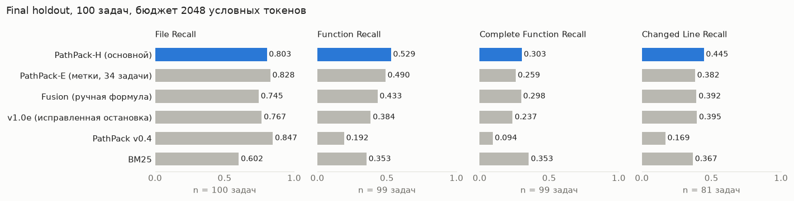

*Рис. 1. Первый holdout, бюджет 2048: четыре метрики по шести методам. Синим выделен вариант, выбранный до прогона.*

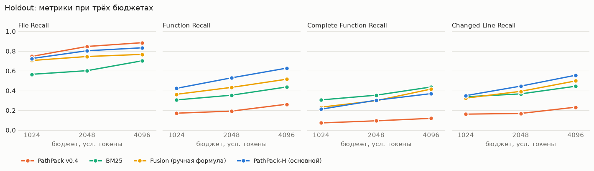

*Рис. 2. Первый holdout: метрики при бюджетах 1024, 2048 и 4096.*

У v0.4 покрытие функций и строк почти не растёт с бюджетом. BM25 выше PathPack-H по Complete Function Recall при всех трёх бюджетах.

Сравнения, заявленные до прогона. В скобках сначала интервал по задачам, затем по репозиториям (9 кластеров).

| Сравнение | Метрика | Разница | 95% ДИ по задачам | 95% ДИ по репозиториям | Побед / ничьих / поражений |
|---|---|---:|---|---|---|
| H − v0.4 | File | −0.043 | [−0.102, +0.017] | [−0.167, +0.019] | 4 / 85 / 11 |
| H − v0.4 | Function | +0.337 | [+0.235, +0.442] | [+0.095, +0.404] | 42 / 52 / 5 |
| H − v0.4 | Complete | +0.209 | [+0.122, +0.301] | [+0.034, +0.263] | 27 / 68 / 4 |
| H − v0.4 | Changed Line | +0.277 | [+0.168, +0.386] | [+0.049, +0.334] | 34 / 41 / 6 |
| H − fusion | File | +0.058 | [−0.000, +0.123] | [−0.018, +0.127] | 10 / 87 / 3 |
| H − fusion | Function | +0.097 | [+0.029, +0.176] | [+0.000, +0.219] | 14 / 81 / 4 |
| H − fusion | Complete | +0.005 | [−0.052, +0.069] | [−0.045, +0.096] | 6 / 87 / 6 |
| H − fusion | Changed Line | +0.053 | [−0.018, +0.129] | [−0.024, +0.174] | 13 / 61 / 7 |

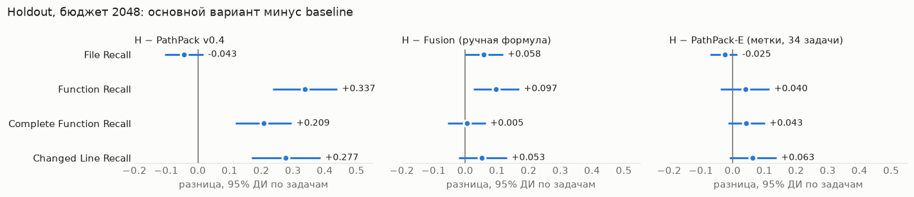

*Рис. 3. Первый holdout, бюджет 2048: разница «PathPack-H минус baseline», 95% интервал парного bootstrap по задачам.*

PathPack-H выше v0.4 по Function, Complete и Changed Line при обоих способах bootstrap. По File разница равна −0.043, интервал включает ноль. Над fusion значим только Function Recall, и при расчёте по репозиториям нижняя граница его интервала равна нулю.

Вторичные сравнения по задачам. H минус E: File −0.025 [−0.065, +0.015], Function +0.040 [−0.037, +0.115], Complete +0.043 [−0.014, +0.105], Changed Line +0.063 [−0.009, +0.134]. У H минус H без графового раунда все четыре интервала включают ноль. Fusion минус v0.4: File −0.102 [−0.173, −0.032], остальные три метрики выше нуля (+0.240, +0.204, +0.224). v1.0e минус v0.4: File −0.080 [−0.152, −0.012], остальные три выше нуля.

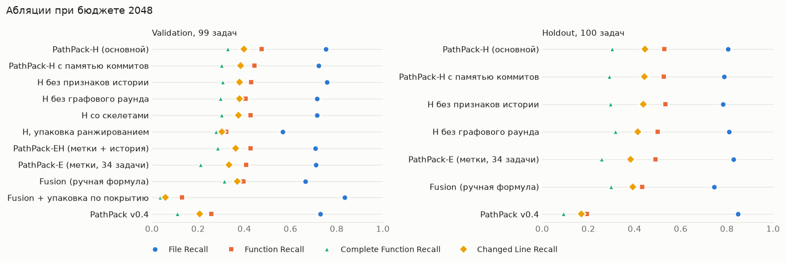

*Рис. 4. Абляции при бюджете 2048: validation слева, первый holdout справа.*

Запрос PathPack-H занимает около 0.42 секунды при готовом индексе. Индекс эмбеддингов на 4096 фрагментов UniXcoder строится несколько минут на задачу.

### 6.5 PathPack-U

#### Validation

PathPack-U разрабатывался после того, как validation уже использовался для выбора варианта PathPack-H. Числа ниже служат проверкой перед отложенным набором, независимой оценкой они не являются.

| Метод | File | Function | Complete | Changed Line | Insertion Anchor |
|---|---:|---:|---:|---:|---:|
| BM25 | 0.469 | 0.295 | 0.295 | 0.259 | 0.213 |
| PathPack v0.4 | 0.728 | 0.258 | 0.112 | 0.207 | 0.145 |
| Fusion | 0.665 | 0.396 | 0.315 | 0.371 | 0.289 |
| PathPack-H | 0.752 | 0.474 | 0.329 | 0.399 | 0.251 |
| PathPack-U | 0.854 | 0.439 | 0.351 | 0.380 | 0.316 |
| U без хода «функция целиком» | 0.844 | 0.445 | 0.316 | 0.373 | 0.313 |

При бюджете 1024 у U получается File 0.828, Function 0.324, Complete 0.212 и Changed Line 0.244, у H 0.688, 0.324, 0.179 и 0.257. При бюджете 4096 у U 0.860, 0.469, 0.404 и 0.428, у H 0.767, 0.555, 0.390 и 0.460.

| Сравнение | File | Function | Complete | Changed Line |
|---|---|---|---|---|
| U − v0.4 | +0.126 [+0.047, +0.207], 17/76/6 | +0.181 [+0.088, +0.274], 25/61/3 | +0.240 [+0.163, +0.327], 28/61/0 | +0.173 [+0.098, +0.255], 22/55/1 |
| U − H | +0.102 [+0.049, +0.165], 12/87/0 | −0.036 [−0.109, +0.039], 5/73/11 | +0.022 [−0.039, +0.090], 7/78/4 | −0.019 [−0.082, +0.042], 6/62/10 |
| U − BM25 | +0.385 [+0.293, +0.478] | +0.143 [+0.054, +0.233] | +0.056 [−0.034, +0.152], 19/59/11 | +0.121 [+0.037, +0.207] |
| U − U без хода | +0.010 [0.000, +0.030] | −0.007 [−0.040, +0.020] | +0.035 [−0.001, +0.081], 5/81/3 | +0.007 [−0.006, +0.028] |

U выше v0.4 по всем четырём метрикам, включая File Recall. Ни один наш прежний вариант этого не достигал. Относительно PathPack-H он добавляет файлы (+0.102 без единого поражения), а по Function, Complete и Changed Line различий нет. При бюджете 4096 Function Recall у U ниже, чем у H (0.469 против 0.555). Ход «функция целиком» на validation почти не влияет.

#### Второй holdout

До прогона заявлены две гипотезы. Первая: U выше v0.4 по Function, Complete и Changed Line и не ниже по File. Вторая: U выше PathPack-H по File. Превосходство U над H по остальным метрикам не заявлялось, потому что validation его не показал.

Хэш исходников после прогона совпал с записанным, аудит бюджетов прошёл. Function и Complete определены на 42 задачах, Changed Line на 38.

| Метод | Бюджет | File | Function | Complete | Changed Line | Insertion Anchor |
|---|---:|---:|---:|---:|---:|---:|
| BM25 | 2048 | 0.588 | 0.365 | 0.365 | 0.346 | 0.190 |
| PathPack v0.4 | 2048 | 0.735 | 0.252 | 0.145 | 0.229 | 0.111 |
| Fusion | 2048 | 0.775 | 0.536 | 0.397 | 0.494 | 0.376 |
| PathPack-H | 2048 | 0.775 | 0.520 | 0.310 | 0.469 | 0.264 |
| PathPack-U | 2048 | 0.863 | 0.508 | 0.417 | 0.414 | 0.329 |
| U без хода «функция целиком» | 2048 | 0.863 | 0.508 | 0.333 | 0.407 | 0.319 |
| PathPack v0.4 | 1024 | 0.618 | 0.157 | 0.073 | 0.173 | 0.048 |
| PathPack-H | 1024 | 0.755 | 0.385 | 0.226 | 0.294 | 0.252 |
| PathPack-U | 1024 | 0.863 | 0.411 | 0.315 | 0.345 | 0.214 |
| PathPack v0.4 | 4096 | 0.892 | 0.339 | 0.232 | 0.308 | 0.219 |
| PathPack-H | 4096 | 0.814 | 0.609 | 0.514 | 0.534 | 0.309 |
| PathPack-U | 4096 | 0.863 | 0.667 | 0.575 | 0.559 | 0.409 |

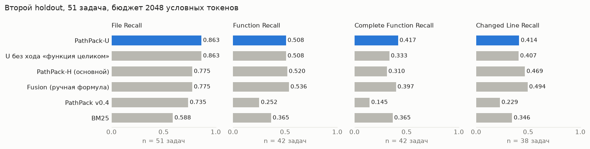

*Рис. 5. Второй holdout, бюджет 2048: четыре метрики по шести методам.*

| Сравнение | Метрика | Разница | 95% ДИ по задачам | 95% ДИ по репозиториям | Побед / ничьих / поражений |
|---|---|---:|---|---|---|
| U − v0.4 | File | +0.127 | [+0.029, +0.235] | [−0.045, +0.274] | 8 / 42 / 1 |
| U − v0.4 | Function | +0.256 | [+0.141, +0.381] | [+0.060, +0.360] | 14 / 28 / 0 |
| U − v0.4 | Complete | +0.272 | [+0.153, +0.403] | [+0.036, +0.388] | 14 / 28 / 0 |
| U − v0.4 | Changed Line | +0.185 | [+0.071, +0.308] | [−0.015, +0.303] | 11 / 25 / 2 |
| U − H | File | +0.088 | [+0.020, +0.167] | [0.000, +0.241] | 5 / 46 / 0 |
| U − H | Function | −0.012 | [−0.119, +0.095] | [−0.158, +0.033] | 3 / 36 / 3 |
| U − H | Complete | +0.107 | [+0.024, +0.214] | [0.000, +0.159] | 5 / 37 / 0 |
| U − H | Changed Line | −0.055 | [−0.150, +0.043] | [−0.160, −0.017] | 3 / 30 / 5 |
| U − fusion | File | +0.088 | [+0.020, +0.167] | [0.000, +0.119] | 5 / 46 / 0 |
| U − fusion | Function | −0.028 | [−0.175, +0.119] | [−0.261, +0.054] | 5 / 30 / 7 |
| U − fusion | Complete | +0.020 | [−0.127, +0.167] | [−0.263, +0.126] | 6 / 30 / 6 |
| U − fusion | Changed Line | −0.080 | [−0.252, +0.091] | [−0.306, −0.005] | 6 / 24 / 8 |
| U − U без хода | Complete | +0.083 | [+0.012, +0.179] | [0.000, +0.122] | 4 / 38 / 0 |

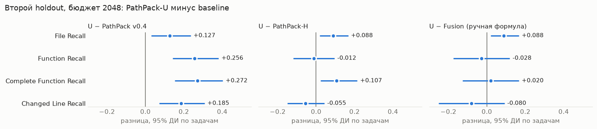

*Рис. 6. Второй holdout, бюджет 2048: PathPack-U минус baseline, 95% интервал по задачам.*

Первая гипотеза подтверждена при bootstrap по задачам: U выше v0.4 по всем четырём метрикам. При расчёте по репозиториям интервалы по Function и Complete остаются выше нуля, а по File и Changed Line включают ноль. Вторая гипотеза подтверждена при bootstrap по задачам (+0.088 без единого поражения), при расчёте по репозиториям нижняя граница равна нулю.

Остальные наблюдения заранее не заявлялись. U выше PathPack-H по Complete Function Recall на 0.107, и этот прирост даёт ход «функция целиком»: без него Complete падает с 0.417 до 0.333 при тех же остальных метриках. На validation тот же эффект был слабее (+0.035). По Changed Line Recall U ниже PathPack-H и fusion по точечной оценке, а при расчёте по репозиториям оба интервала лежат ниже нуля. Ручной fusion на этом наборе не хуже обученных вариантов по Function и Changed Line. BM25 значимо уступает U только по File (+0.275 [+0.157, +0.392]). По Function, Complete и Changed Line интервалы разницы с BM25 включают ноль.

Запрос U на этом прогоне занял 0.34 секунды, столько же, сколько у H. На validation измеренная латентность U была около 1.2 секунды, но тот прогон шёл одновременно с другими вычислениями, и эти два измерения сравнивать нельзя.

### 6.6 Третий holdout: 125 задач, незнакомые репозитории и вклад частей PathPack-U

Второй holdout мал, а история для обучения и задачи для оценки брались из одних репозиториев. Третий отложенный набор закрывает оба пробела. В него вошли 125 задач train-pool, которые ни разу не извлекались и не оценивались: django 84, sympy 23, sphinx 9, matplotlib 5, scikit-learn 4. Манифест записан до измерений.

До прогона заявлены три гипотезы. Первая: U выше v0.4 по всем четырём метрикам. Вторая: U выше PathPack-H по File и Complete. Третья: модели, обученные без истории репозитория задачи, выше v0.4 по Function, Complete и Changed Line. Хэш исходников после прогона совпал с записанным, аудит бюджетов прошёл. Function и Complete определены на 106 задачах, Changed Line на 99.

| Метод | Бюджет | File | Function | Complete | Changed Line | Insertion Anchor |
|---|---:|---:|---:|---:|---:|---:|
| BM25 | 2048 | 0.465 | 0.358 | 0.358 | 0.328 | 0.154 |
| PathPack v0.4 | 2048 | 0.649 | 0.186 | 0.115 | 0.156 | 0.040 |
| Fusion | 2048 | 0.645 | 0.433 | 0.317 | 0.368 | 0.154 |
| PathPack-H | 2048 | 0.635 | 0.448 | 0.255 | 0.385 | 0.207 |
| PathPack-U | 2048 | 0.765 | 0.419 | 0.340 | 0.352 | 0.157 |
| U без хода «функция целиком» | 2048 | 0.761 | 0.425 | 0.284 | 0.349 | 0.157 |
| U с noisy-OR вместо обученных уровней | 2048 | 0.765 | 0.421 | 0.319 | 0.342 | 0.112 |
| PathPack-H без истории своего репозитория | 2048 | 0.639 | 0.443 | 0.259 | 0.368 | 0.234 |
| PathPack-U без истории своего репозитория | 2048 | 0.757 | 0.427 | 0.335 | 0.352 | 0.197 |
| PathPack v0.4 | 1024 | 0.571 | 0.141 | 0.102 | 0.135 | 0.022 |
| PathPack-H | 1024 | 0.607 | 0.366 | 0.198 | 0.286 | 0.166 |
| PathPack-U | 1024 | 0.737 | 0.322 | 0.240 | 0.282 | 0.102 |
| PathPack v0.4 | 4096 | 0.764 | 0.245 | 0.153 | 0.194 | 0.040 |
| PathPack-H | 4096 | 0.679 | 0.543 | 0.368 | 0.471 | 0.259 |
| PathPack-U | 4096 | 0.786 | 0.543 | 0.469 | 0.460 | 0.233 |

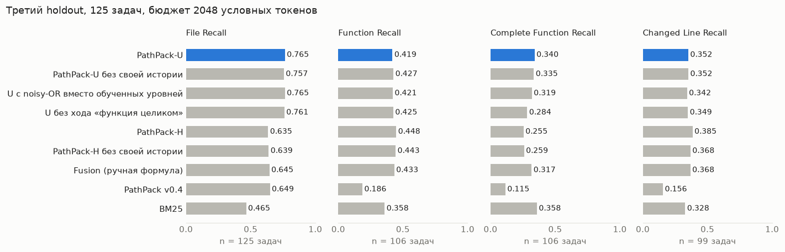

*Рис. 7. Третий holdout, бюджет 2048: четыре метрики по девяти вариантам.*

#### Заявленные сравнения

Первый интервал посчитан по задачам, второй по репозиториям (5 кластеров).

| Сравнение | Метрика | Разница | 95% ДИ по задачам | 95% ДИ по репозиториям | Побед / ничьих / поражений |
|---|---|---:|---|---|---|
| U − v0.4 | File | +0.116 | [+0.056, +0.180] | [+0.100, +0.222] | 18 / 105 / 2 |
| U − v0.4 | Function | +0.233 | [+0.143, +0.319] | [+0.167, +0.306] | 35 / 67 / 4 |
| U − v0.4 | Complete | +0.226 | [+0.156, +0.301] | [+0.135, +0.251] | 29 / 77 / 0 |
| U − v0.4 | Changed Line | +0.196 | [+0.112, +0.285] | [+0.087, +0.231] | 31 / 61 / 7 |
| U − H | File | +0.130 | [+0.078, +0.187] | [+0.016, +0.147] | 20 / 105 / 0 |
| U − H | Complete | +0.085 | [+0.025, +0.149] | [+0.029, +0.114] | 16 / 86 / 4 |
| U − H | Function | −0.029 | [−0.109, +0.050] | [−0.053, +0.069] | 12 / 78 / 16 |
| U − H | Changed Line | −0.033 | [−0.114, +0.046] | [−0.071, +0.017] | 12 / 69 / 18 |

Первая гипотеза подтверждена: U выше v0.4 по всем четырём метрикам, и все восемь интервалов лежат выше нуля. Вторая подтверждена: U выше PathPack-H по File (ни одного поражения) и по Complete при обоих способах расчёта. По Function и Changed Line U и H неразличимы.

PathPack-H против v0.4 на этом наборе повторяет результат первого holdout: Function +0.262 [+0.176, +0.349], Complete +0.141 [+0.073, +0.209], Changed Line +0.229 [+0.148, +0.315], File −0.014 [−0.080, +0.048].

#### Незнакомые репозитории

Для каждого из пяти репозиториев набора модель фрагмента и модели функции и файла обучены заново на псевдо-задачах остальных одиннадцати репозиториев. Задачи репозитория оцениваются моделью, которая его историю не видела. Признаки истории самого репозитория на этапе применения остаются.

| Сравнение | File | Function | Complete | Changed Line |
|---|---|---|---|---|
| U без своей истории − v0.4 | +0.108 [+0.048, +0.168] | +0.240 [+0.151, +0.330] | +0.220 [+0.151, +0.296] | +0.196 [+0.114, +0.286] |
| H без своей истории − v0.4 | −0.010 [−0.070, +0.054] | +0.257 [+0.183, +0.343] | +0.145 [+0.085, +0.212] | +0.212 [+0.138, +0.292] |
| U без своей истории − U | −0.008 [−0.040, +0.016] | +0.008 [−0.025, +0.045] | −0.006 [−0.035, +0.024] | 0.000 [−0.036, +0.040] |
| H без своей истории − H | +0.004 [−0.040, +0.048] | −0.005 [−0.045, +0.033] | +0.004 [−0.046, +0.054] | −0.016 [−0.052, +0.021] |

Третья гипотеза подтверждена. Обе модели без истории своего репозитория выше v0.4 по Function, Complete и Changed Line, а U ещё и по File. Разница между моделью без своей истории и моделью со своей историей не превышает 0.016 по модулю, все восемь интервалов включают ноль. В 99 задачах из 106 Function Recall у двух вариантов U совпадает. Обучение на истории не запоминает конкретный репозиторий: модель, обученная на других проектах, работает так же.

Оговорка: в наборе пять репозиториев, все они есть в SWE-bench и все написаны на Python. Перенос на проект другого типа этим экспериментом не проверен.

#### Что в PathPack-U даёт вклад

| Сравнение | File | Function | Complete | Changed Line |
|---|---|---|---|---|
| U − U с noisy-OR | 0.000 [0.000, 0.000] | −0.002 [−0.067, +0.061] | +0.021 [−0.028, +0.073] | +0.010 [−0.043, +0.062] |
| U − U без хода «функция целиком» | +0.004 [0.000, +0.012] | −0.006 [−0.044, +0.028] | +0.057 [+0.018, +0.104] | +0.003 [−0.030, +0.038] |
| U − fusion | +0.120 [+0.062, +0.184] | −0.014 [−0.084, +0.054] | +0.023 [−0.036, +0.085] | −0.016 [−0.079, +0.051] |
| U − BM25 | +0.300 [+0.221, +0.378] | +0.060 [−0.037, +0.155] | −0.018 [−0.115, +0.076] | +0.024 [−0.066, +0.113] |

Две обученные модели уровня функции и файла вклада не дают. Вариант, где эти вероятности считаются простым noisy-OR по вероятностям фрагментов, неотличим от полного по всем четырём метрикам. Выигрыш U над H по файлам создаёт сама цель упаковки с явными слагаемыми для файла и функции. Ход «функция целиком» добавляет 0.057 к Complete Function Recall, интервал по задачам лежит выше нуля. Это согласуется со вторым holdout.

Над fusion U выигрывает только по File. Над BM25 тоже только по File, а по Complete Function Recall BM25 на этом наборе не хуже (0.358 против 0.340).

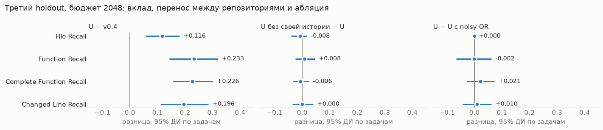

*Рис. 8. Третий holdout, бюджет 2048: U минус v0.4, U без истории своего репозитория минус U, U минус U с noisy-OR. 95% интервал по задачам.*

### 6.7 Статический тестовый мост

Мы проверили ещё один канал. Текст задачи сопоставлялся с существующими тестовыми функциями по BM25 (имя и тело теста), и балл переносился по статическим рёбрам графа от теста к коду, который тест вызывает, наследует или импортирует. IssueExec и Issue-Test-Localizer строят такой мост по трассам исполнения и покрытию. Наш вариант тесты не запускает.

Проба шла на 22 задачах train-pool, 16 из них с положительными примерами. Признаки моста не отделяют правленые фрагменты от остальных: AUC 0.496 на уровне функции, 0.517 на уровне класса и 0.510 на уровне файла по всему пулу, и 0.50 внутри нужных файлов. Лексический балл на тех же задачах даёт 0.811 и 0.731. В matplotlib статических рёбер от тестов к коду не нашлось ни одного. В алгоритм канал не включён.

### 6.8 Локализация моделью Gemma 4 по упакованному контексту

Метрики выше показывают, что нужный код попал в контекст. Они не показывают, может ли малая модель им воспользоваться. Мы проверили это на локальной Gemma 4 (`gemma4:e2b-mlx` в Ollama, температура 0, seed 0, окно 8192 токена). Модель получает текст задачи и контекст метода на 2048 условных токенов и называет одну функцию, которую нужно править, в формате JSON. Ответ засчитывается по файлу, если названный файл входит в эталонный патч, и по функции, если названная функция в этом файле изменена патчем. План сравнений записан до подсчёта ответов (`output/llm_probe/PLAN.json`). Все 1280 ответов оказались корректным JSON.

Контексты взяты из уже посчитанных отложенных прогонов, сами ответы модели до этого не оценивались. PathPack-U на первом holdout не запускался, поэтому там его нет. Третий набор добавлен в план до генерации ответов на нём.

| Набор | Метод | Файл назван верно | Функция названа верно |
|---|---|---:|---:|
| первый holdout, 100 задач | BM25 | 0.560 | 0.354 |
| | PathPack v0.4 | 0.660 | 0.364 |
| | Fusion | 0.700 | 0.434 |
| | PathPack-H | 0.710 | 0.505 |
| второй holdout, 51 задача | BM25 | 0.569 | 0.286 |
| | PathPack v0.4 | 0.647 | 0.500 |
| | Fusion | 0.706 | 0.429 |
| | PathPack-H | 0.706 | 0.500 |
| | PathPack-U | 0.804 | 0.524 |
| третий holdout, 125 задач | BM25 | 0.416 | 0.358 |
| | PathPack v0.4 | 0.432 | 0.264 |
| | Fusion | 0.536 | 0.358 |
| | PathPack-H | 0.544 | 0.406 |
| | PathPack-U | 0.568 | 0.377 |

Точность по функции считается на 99 задачах первого набора, на 42 задачах второго и на 106 задачах третьего.

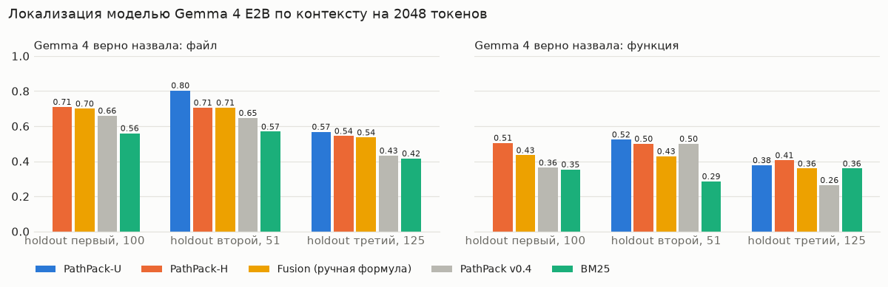

*Рис. 9. Доля задач, в которых Gemma 4 E2B верно назвала файл и функцию для правки, по трём отложенным наборам.*

Разница с v0.4, 95% интервал парного bootstrap по задачам и счёт побед, ничьих и поражений:

| Набор | Сравнение | Файл | Функция |
|---|---|---|---|
| первый | H − v0.4 | +0.050 [−0.040, +0.140], 12/81/7 | +0.141 [+0.040, +0.242], 22/69/8 |
| первый | fusion − v0.4 | +0.040 [−0.050, +0.130], 12/80/8 | +0.071 [−0.040, +0.182], 20/66/13 |
| первый | BM25 − v0.4 | −0.100 [−0.190, −0.010], 5/80/15 | −0.010 [−0.121, +0.101], 15/68/16 |
| второй | U − v0.4 | +0.157 [+0.059, +0.255], 8/43/0 | +0.024 [−0.143, +0.190], 7/29/6 |
| второй | H − v0.4 | +0.059 [−0.059, +0.196], 7/40/4 | 0.000 [−0.167, +0.190], 7/28/7 |
| второй | fusion − v0.4 | +0.059 [−0.078, +0.196], 8/38/5 | −0.071 [−0.262, +0.119], 7/25/10 |
| второй | BM25 − v0.4 | −0.078 [−0.196, +0.039], 3/41/7 | −0.214 [−0.381, −0.024], 4/25/13 |
| третий | U − v0.4 | +0.136 [+0.064, +0.216], 22/98/5 | +0.113 [+0.019, +0.208], 19/80/7 |
| третий | H − v0.4 | +0.112 [+0.032, +0.200], 21/97/7 | +0.142 [+0.047, +0.236], 21/79/6 |
| третий | fusion − v0.4 | +0.104 [+0.024, +0.184], 21/96/8 | +0.094 [0.000, +0.179], 18/80/8 |
| третий | BM25 − v0.4 | −0.016 [−0.096, +0.064], 11/101/13 | +0.094 [0.000, +0.198], 20/76/10 |

На первом holdout Gemma с контекстом PathPack-H называет нужную функцию в 50.5% задач против 36.4% с контекстом v0.4, интервал разницы лежит выше нуля. На втором holdout с контекстом PathPack-U она чаще называет нужный файл (0.804 против 0.647, ни одного поражения), а по функции разницы нет: v0.4 на этом наборе сам даёт 0.500. Выигрыш по функции с первого набора на втором не повторился.

На третьем holdout, самом большом и не тронутом до этого, оба метода выше v0.4 по обоим показателям, и все четыре интервала лежат выше нуля. С контекстом PathPack-H модель верно называет функцию в 40.6% задач против 26.4%, с контекстом PathPack-U в 37.7%. Между собой U, H и fusion в этой пробе неразличимы: U минус H даёт +0.024 [−0.040, +0.088] по файлу и −0.028 [−0.113, +0.057] по функции.

По трём наборам это выглядит так. Контекст PathPack-H повышает точность Gemma по функции на двух наборах из трёх. Контекст PathPack-U повышает точность по файлу на обоих наборах, где он запускался, и по функции на одном из двух.

Проба измеряет локализацию моделью. Патч не генерировался и тесты не запускались, поэтому о доле исправленных ошибок она ничего не говорит. Проверена одна модель и один шаблон запроса.

## 7. Обсуждение

На отложенных данных подтверждено следующее. PathPack-H выше v0.4 по Function, Complete и Changed Line при обоих способах bootstrap, File Recall при этом в пределах интервала. PathPack-U выше v0.4 по всем четырём метрикам на втором и третьем наборах и выше PathPack-H по File Recall, а на третьем наборе и по Complete Function Recall. Модели, обученные без истории репозитория задачи, от обычных не отличаются.

Не подтверждено следующее. Превосходство обученной модели над ручным fusion ограничено Function Recall на первом holdout, а на втором fusion не хуже по Function и Changed Line. Модель на истории и модель на метках неразличимы, причём E обучалась всего на 34 задачах, так что из этого следует только взаимозаменяемость двух источников в таком режиме. Память коммитов, признаки истории, строки сигнатур и тестовый мост вклада не дали. Вклад графового раунда лежит в пределах шума. Обученные модели уровня функции и файла в PathPack-U не лучше noisy-OR.

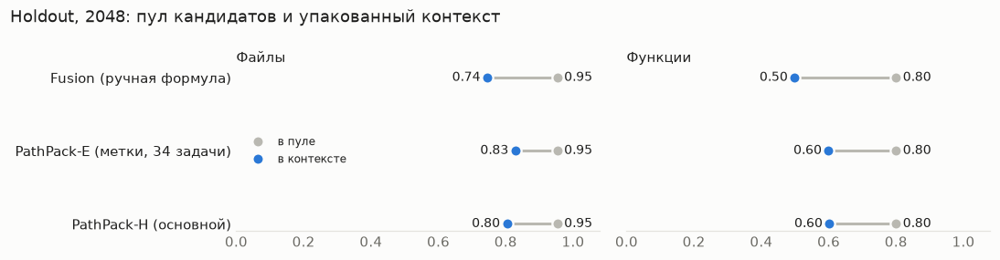

*Рис. 10. Первый holdout, бюджет 2048: доля нужных файлов и функций в пуле кандидатов и в упакованном контексте.*

В пуле лежит 0.95 нужных файлов и 0.80 нужных функций. В контекст PathPack-H попадает 0.80 файлов и 0.60 функций, у fusion 0.74 и 0.50. Запас остаётся на этапе выбора.

PathPack-U меняет распределение бюджета. Относительно v0.4 все четыре метрики растут одновременно на validation и на втором holdout. Относительно PathPack-H набор меняется иначе: файлов и целых функций становится больше, функций по порогу 20% столько же, строк по точечной оценке меньше. Различать функции внутри правильного файла U лучше не стал. Ни упаковка, ни проверенные дополнительные сигналы эту способность не улучшили.

BM25 сильнее PathPack-H по Complete Function Recall при всех бюджетах первого holdout (0.353 против 0.303 при 2048), потому что кладёт функции целиком. PathPack-U с ходом «функция целиком» на втором holdout выше BM25 по точечной оценке (0.417 против 0.365), интервал разницы включает ноль.

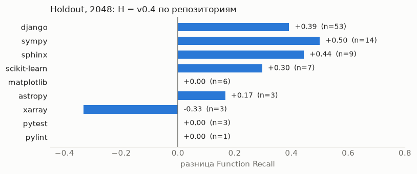

*Рис. 11. Первый holdout, бюджет 2048: разница Function Recall «PathPack-H минус v0.4» по репозиториям, с числом задач.*

Выигрыш H над v0.4 по Function сосредоточен в django (+0.39), sympy (+0.50), sphinx (+0.44) и scikit-learn (+0.30). В xarray H хуже на трёх задачах. В matplotlib, pytest и pylint разницы по Function нет. В малых репозиториях от 1 до 6 задач, выводы по ним ненадёжны.

На новых задачах v0.4 уступает BM25 по Function, Complete и Changed Line. На 20 диагностических задачах он был лучшим по File Recall и оставался нашим основным методом. Маленький набор, использованный много раз, привёл к методу, который хорошо покрывает файлы и плохо покрывает функции.

## 8. Ограничения

- Наборы малы. В validation 99 задач, в первом holdout 100, во втором 51. При расчёте по репозиториям кластеров 9, а django составляет 54 задачи из 100 в первом holdout и 27 из 51 во втором.
- Validation использован дважды: для выбора варианта PathPack-H и для проверки PathPack-U.
- Основной вариант PathPack-H выбран как лучший из нескольких на validation. Абляции на отложенных наборах являются вторичным анализом без поправки на множественные сравнения.
- Перенос проверен только внутри 12 репозиториев SWE-bench: модель обучалась на одиннадцати и оценивалась на двенадцатом, в оценке участвовали пять репозиториев. Все они написаны на Python и похожи по устройству. Проект другого типа не проверялся.
- В третьем holdout 84 задачи из 125 относятся к django.
- Метки replay приблизительны: функция берётся из заголовка ханка, а код из более позднего снимка.
- Контроль на метках слаб: 34 размеченные задачи.
- У 16 из 20 диагностических задач разметка неполная.
- Токены условные. Абсолютные значения бюджета на Gemma не переносятся.
- Эксперимент с LLM ограничен локализацией: одна модель (Gemma 4 E2B), один шаблон запроса, без генерации патча и без запуска тестов. Долю исправленных ошибок мы не измеряли.
- Рассмотрен только Python.
- Эмбеддинги UniXcoder-base не сравнивались с SweRankEmbed. CodeT5+ не загрузился на установленной версии transformers.
- Прямого сравнения с CommitCompass и SweRank нет, их метрики другие.

## 9. Воспроизводимость

Репозиторий: https://github.com/ArduRadioKot/PathPack. Коммит: [SHA будет указан до подачи]. Файлы заморозки: https://github.com/ArduRadioKot/PathPack/tree/main/output/pathpack_e. Сплиты и манифесты: https://github.com/ArduRadioKot/PathPack/tree/main/output/pathpack_r_splits_v2. Ноутбук с таблицами и рисунками: https://github.com/ArduRadioKot/PathPack/blob/main/notebooks/11_pathpack_h.ipynb. Сводки прогонов: https://github.com/ArduRadioKot/PathPack/tree/main/output.

```bash
# сплиты (заморожены)
output/pathpack_r_splits_v2/manifest.json
output/pathpack_r_splits_v2/final_holdout_100_manifest.json
output/pathpack_r_splits_v2/final_holdout2_manifest.json

# диагностика
PYTHONPATH=src python -m codegraph_rag.pathpack_r benchmark --out output/pathpack_r_diag --split dev
PYTHONPATH=src python -m codegraph_rag.pathpack_r score --out output/pathpack_r_diag

# PathPack-H: логи коммитов, псевдо-задачи, обучение, validation, первый holdout
PYTHONPATH=src python -m codegraph_rag.pathpack_r.history_replay fetch
PYTHONPATH=src python -m codegraph_rag.pathpack_r.history_replay build
sh output/pathpack_e/chain_val.sh
output/pathpack_e/FREEZE_before_holdout.json
output/pathpack_holdout/

# PathPack-U: модели функции и файла, validation, второй holdout
PYTHONPATH=src python -m codegraph_rag.pathpack_r.hier_model --exclude output/pathpack_r_splits_v2/validation_issues.jsonl output/pathpack_r_splits_v2/final_holdout_issues.jsonl output/benchmark/issues.jsonl
output/pathpack_e/FREEZE_before_holdout2.json
output/pathpack_holdout2/

# третий holdout и модели без репозитория задачи
PYTHONPATH=src python scripts/fit_loro.py django/django   # и так для каждого репозитория набора
sh output/pathpack_e/chain_h3.sh
output/pathpack_e/FREEZE_before_holdout3.json
output/pathpack_holdout3/  output/pathpack_holdout3_loro/

# PathPack-E (только train-pool)
PYTHONPATH=src python -m codegraph_rag.pathpack_r.edit_train build --issues output/pathpack_r_splits_v2/train_110.jsonl
PYTHONPATH=src python -m codegraph_rag.pathpack_r.edit_train fit --exclude output/pathpack_r_splits_v2/validation_issues.jsonl output/pathpack_r_splits_v2/final_holdout_100_issues.jsonl

# проба локализации моделью Gemma 4 (нужен запущенный Ollama с gemma4:e2b-mlx)
python scripts/llm_localize.py ask output/pathpack_holdout output/pathpack_r_splits_v2/final_holdout_100_issues.jsonl output/llm_probe/holdout1.jsonl 2048:999 bm25 pathpack-v4 pathpack-r/fusion pathpack-h/nomemory
PYTHONPATH=src python scripts/llm_localize.py score output/pathpack_holdout output/llm_probe/holdout1.jsonl

# проба тестового моста
PYTHONPATH=src python scripts/probe_test_bridge.py 22
```

Таблицы и рисунки строит `notebooks/11_pathpack_h.ipynb`, который генерируется скриптом `scripts/write_pathpack_h_notebook.py` и читает числа из файлов прогонов. Тесты лежат в `tests/test_pathpack_e.py`, `tests/test_pathpack_r.py` и `tests/test_pathpack_v10e.py`, всего 33, все проходят. Эмбеддинги считались на Apple Silicon с `CODEGRAPH_DEVICE=mps`. Косинус между векторами MPS и CPU на пробе из 256 фрагментов не ниже 0.9999998.

## 10. Заключение

Модель вероятности правки, обученная воспроизведением прошлых коммитов без меток бенчмарка, вместе с упаковкой по ожидаемому покрытию на токен покрывает на 100 отложенных задачах SWE-bench Verified примерно в 2.7 раза больше изменяемых функций и в 2.6 раза больше изменённых строк, чем наш прежний метод v0.4, при сопоставимом покрытии файлов. Над ручным слиянием тех же каналов выигрыш скромный и значим только по Function Recall.

Упаковка под сумму ожидаемых метрик на двух отложенных наборах из 51 и 125 задач выше v0.4 по всем четырём метрикам, включая покрытие файлов. К PathPack-H она добавляет файлы и целые функции и не добавляет строк. Вклад даёт сама цель упаковки, а отдельные обученные модели функции и файла оказались не нужны.

Модель, обученная на истории одиннадцати репозиториев, работает на двенадцатом так же, как модель, видевшая его историю.

Признаки истории, память коммитов и статический тестовый мост не помогли. История оказалась полезна как источник обучающих примеров.

Локальная Gemma 4 с контекстом PathPack-H чаще верно называет функцию для правки на первом и третьем отложенных наборах, а с контекстом PathPack-U чаще верно называет файл на втором и третьем и функцию на третьем. Влияние на долю исправленных ошибок не измерялось, и это главный открытый вопрос.

## Литература

Библиографические данные сверены со страницами arXiv 11 ноября 2026 года.

- Chen Z., Tang X., Deng G., Wu F., Wu J., Jiang Z., Prasanna V., Cohan A., Wang X. LocAgent: Graph-Guided LLM Agents for Code Localization. [arXiv:2503.09089](https://arxiv.org/abs/2503.09089), 2025.
- CommitCompass. Репозиторий [github.com/VijayChamakuri/commitcompass](https://github.com/VijayChamakuri/commitcompass), нерецензируемый проект, просмотрен 11.11.2026.
- Gandhi S., Gao L., Callan J. Repository-level Code Search with Neural Retrieval Methods. [arXiv:2502.07067](https://arxiv.org/abs/2502.07067), 2025.
- IssueExec: A Test-Driven Approach for Localizing Software Engineering Issues. [arXiv:2607.17286](https://arxiv.org/abs/2607.17286), 2026. Авторы и детали по полному тексту не сверены.
- Issue-Test-Localizer. Репозиторий [github.com/IBM/Issue-Test-Localizer](https://github.com/IBM/Issue-Test-Localizer). Просмотрена только поисковая выдача.
- Jiang Z., Ren X., Yan M., Jiang W., Li Y., Liu Z. Issue Localization via LLM-Driven Iterative Code Graph Searching (CoSIL). [arXiv:2503.22424](https://arxiv.org/abs/2503.22424). ASE 2025.
- Jimenez C. E., Yang J., Wettig A., Yao S., Pei K., Press O., Narasimhan K. SWE-bench: Can Language Models Resolve Real-World GitHub Issues? [arXiv:2310.06770](https://arxiv.org/abs/2310.06770). ICLR 2024.
- Reddy R. G., Suresh T., Doo J., Liu Y., Nguyen X. P., Zhou Y., Yavuz S., Xiong C., Ji H., Joty S. SweRank: Software Issue Localization with Code Ranking. [arXiv:2505.07849](https://arxiv.org/abs/2505.07849). ICLR 2026.
- Wang B., Xu W., Li Y., Gao M., Xie Y., Sun H., Chen D. Improving Code Localization with Repository Memory. [arXiv:2510.01003](https://arxiv.org/abs/2510.01003). ICLR 2026.
- Wen M., Wu R., Cheung S.-C. Locus: Locating Bugs from Software Changes. ASE 2016. [Preprint](https://cse.hkust.edu.hk/faculty/scc/publ/ase16-Locus-preprint.pdf).
- Xia C. S., Deng Y., Dunn S., Zhang L. Agentless: Demystifying LLM-based Software Engineering Agents. [arXiv:2407.01489](https://arxiv.org/abs/2407.01489), 2024.
- Yu Z., Zhang H., Zhao Y., Huang H., Yao M., Ding K., Zhao J. OrcaLoca: An LLM Agent Framework for Software Issue Localization. [arXiv:2502.00350](https://arxiv.org/abs/2502.00350). ICML 2025 (PMLR 267).
- Zhou J., Zhang H., Lo D. Where Should the Bugs Be Fixed? More Accurate Information Retrieval-Based Bug Localization Based on Bug Report. ICSE 2012.
- Li H. и соавт. ContextBench: A Benchmark for Context Retrieval in Coding Agents. [arXiv:2602.05892](https://arxiv.org/abs/2602.05892), 2026.
- Zhang S. и соавт. SWE-Explore: Benchmarking How Coding Agents Explore Repositories. [arXiv:2606.07297](https://arxiv.org/abs/2606.07297), 2026.
- Qin B., Xie Y. Agent Retrieval Bench: Evaluating Repository Context Retrieval for Coding Agents. [arXiv:2607.24882](https://arxiv.org/abs/2607.24882), 2026.
